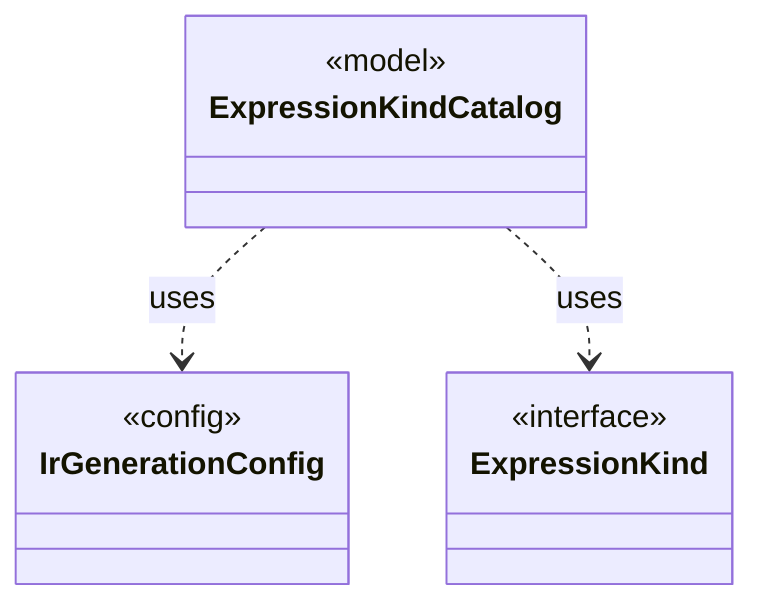

# `ExpressionKindCatalog`

`io.github.tlaplus.hardening.gen.engine` · class · model · key · [source](https://github.com/tlaplus/model-checker-hardening/blob/4c5cb469fa5cdcada2cd5740bce130b825b35343/src/main/java/io/github/tlaplus/hardening/gen/engine/ExpressionKindCatalog.java#L21) · module [gen](../modules/gen.md)

The catalog of every expression form, in decoder order.

The diagram draws 2 of 20 relations; the table lists them all.

| Direction | Relation | Type | Summary |
|---|---|---|---|
| → | uses | [IrGenerationConfig](io.github.tlaplus.hardening.gen.IrGenerationConfig.md) | Settings for generated TLA+ expressions and modules. |
| → | uses | [ExpressionKind](io.github.tlaplus.hardening.gen.engine.ExpressionKind.md) | A selectable expression form grouped by the component that constructs it. |
| → | depends | [ApplicativeExpressionKind](io.github.tlaplus.hardening.gen.engine.ApplicativeExpressionKind.md) | Reads, updates and domains of records, tuples and sequences. |
| → | depends | [BooleanExpressionKind](io.github.tlaplus.hardening.gen.engine.BooleanExpressionKind.md) | Boolean-valued expression forms. |
| → | depends | [CustomExpressionKind](io.github.tlaplus.hardening.gen.engine.CustomExpressionKind.md) | One configured operator kind; its type scheme comes from the immutable prepared library. |
| → | depends | [GeneralExpressionKind](io.github.tlaplus.hardening.gen.engine.GeneralExpressionKind.md) | Type-polymorphic and terminal expression forms. |
| → | depends | [IntegerExpressionKind](io.github.tlaplus.hardening.gen.engine.IntegerExpressionKind.md) | Integer-valued expression forms. |
| → | depends | [IrExprGenFactory](io.github.tlaplus.hardening.gen.engine.IrExprGenFactory.md) | Factory for deferred, type-directed expression generators within one generation run. |
| → | depends | [OtherExpressionKind](io.github.tlaplus.hardening.gen.engine.OtherExpressionKind.md) | Expression forms not covered by the dedicated type and general families. |
| → | depends | [SequenceExpressionKind](io.github.tlaplus.hardening.gen.engine.SequenceExpressionKind.md) | Sequence-valued expression forms. |
| → | depends | [SetExpressionKind](io.github.tlaplus.hardening.gen.engine.SetExpressionKind.md) | Set-valued expression forms. |
| → | depends | [TemporalActionExpressionKind](io.github.tlaplus.hardening.gen.engine.TemporalActionExpressionKind.md) | The temporal formulas over an action that Specifying Systems defines: an action occurs in a temporal formula only through them and through fairness. |
| → | depends | [OperatorId](io.github.tlaplus.hardening.gen.library.OperatorId.md) | Case-sensitive identity of an exported operator, independent of its generated name. |
| → | depends | [OperatorLibrary](io.github.tlaplus.hardening.gen.library.OperatorLibrary.md) | Immutable prepared library. |
| ← | depends | [ExpressionKind](io.github.tlaplus.hardening.gen.engine.ExpressionKind.md) | A selectable expression form grouped by the component that constructs it. |
| ← | depends | [IrExprGenFactory](io.github.tlaplus.hardening.gen.engine.IrExprGenFactory.md) | Factory for deferred, type-directed expression generators within one generation run. |
| ← | depends | [IrGeneratorEngine](io.github.tlaplus.hardening.gen.engine.IrGeneratorEngine.md) | Reusable coordinator for type-directed IR-expression generation. |
| ← | depends | [IrGraphGeneratorEngine](io.github.tlaplus.hardening.gen.engine.IrGraphGeneratorEngine.md) | Reusable decoder of graph inputs (ADR 0023 §2, §3): a control graph whose nodes carry assignment-only actions, tracked by the variable `pc`, and the invariant `pc /= k`. |
| ← | depends | [IrSpecGeneratorEngine](io.github.tlaplus.hardening.gen.engine.IrSpecGeneratorEngine.md) | Reusable coordinator for generating the declarations of one TLA+ module. |
| ← | depends | [OperandGenerator](io.github.tlaplus.hardening.gen.engine.OperandGenerator.md) | Draws expressions for a rewrite that leaves an operand open (ADR 0017 §3), and for the parameters of an edge guard of a graph module (ADR 0023 §6): an operand is drawn by the ordinary expression factory, at its type, in the lexical scope of the rewritten node or the edge, and in the state-level context, so an operand adds no prime. |
