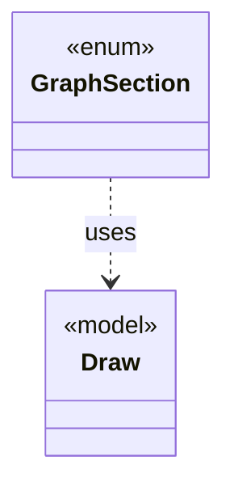

# `GraphSection`

`io.github.tlaplus.hardening.gen.engine` · enum · other · [source](https://github.com/tlaplus/model-checker-hardening/blob/b96eff75a5bbf8a60b15ad020d6e84735c75a47c/src/main/java/io/github/tlaplus/hardening/gen/engine/GraphSection.java#L17) · module [gen](../modules/gen.md)

The independent parts of a graph input after its header, each decoded from its own contiguous range of bytes (ADR 0023 §3), as `ModuleSection` does for a module input.

**Decisions:** [ADR 0023: Graph-based testing](https://github.com/tlaplus/model-checker-hardening/blob/b96eff75a5bbf8a60b15ad020d6e84735c75a47c/docs/decisions/0023-graph-based-testing.md)

The diagram draws 1 of 3 relations; the table lists them all.

| Direction | Relation | Type | Summary |
|---|---|---|---|
| → | uses | [Draw](io.github.tlaplus.hardening.gen.Draw.md) | A forward-only deterministic cursor that decodes structured choices from an unstructured byte array. |
| → | depends | [WeightedSlices](io.github.tlaplus.hardening.gen.engine.WeightedSlices.md) | Divides the remaining bytes of a cursor into contiguous slices of proportional length. |
| ← | depends | [IrGraphGeneratorEngine](io.github.tlaplus.hardening.gen.engine.IrGraphGeneratorEngine.md) | Reusable decoder of graph inputs (ADR 0023 §2, §3): a control graph whose nodes carry assignment-only actions, tracked by the variable `pc`, and the invariant `pc /= k`. |
