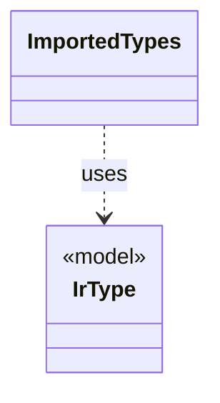

# `ImportedTypes`

`io.github.tlaplus.hardening.gen.engine` · class · other · [source](https://github.com/tlaplus/model-checker-hardening/blob/21262d9d0cc07b5ae4c47c4ee511217c9b88b561/src/main/java/io/github/tlaplus/hardening/gen/engine/ImportedTypes.java#L8) · module [gen](../modules/gen.md)

Converts concrete imported type terms at the private generator boundary.

The diagram draws 1 of 14 relations; the table lists them all.

| Direction | Relation | Type | Summary |
|---|---|---|---|
| → | uses | [IrType](io.github.tlaplus.hardening.gen.engine.IrType.md) | Internal type model used to direct checked expression construction. |
| → | depends | [ConstantType](io.github.tlaplus.hardening.gen.engine.ConstantType.md) | Model-value type. |
| → | depends | [Field](io.github.tlaplus.hardening.gen.engine.Field.md) | Named component of a record or variant type. |
| → | depends | [FunctionType](io.github.tlaplus.hardening.gen.engine.FunctionType.md) | Function type. |
| → | depends | [OperatorType](io.github.tlaplus.hardening.gen.engine.OperatorType.md) | Operator type. |
| → | depends | [PrimitiveType](io.github.tlaplus.hardening.gen.engine.PrimitiveType.md) | Primitive expression result types. |
| → | depends | [RecordType](io.github.tlaplus.hardening.gen.engine.RecordType.md) | Record type. |
| → | depends | [SequenceType](io.github.tlaplus.hardening.gen.engine.SequenceType.md) | Sequence type. |
| → | depends | [SetType](io.github.tlaplus.hardening.gen.engine.SetType.md) | Set type. |
| → | depends | [TupleType](io.github.tlaplus.hardening.gen.engine.TupleType.md) | Tuple type. |
| → | depends | [VariantType](io.github.tlaplus.hardening.gen.engine.VariantType.md) | Variant type. |
| ← | depends | [IrExprGenFactory](io.github.tlaplus.hardening.gen.engine.IrExprGenFactory.md) | Factory for deferred, type-directed expression generators within one generation run. |
| ← | depends | [IrTypeGenFactory](io.github.tlaplus.hardening.gen.engine.IrTypeGenFactory.md) | Factory for deferred generators of internal types within the configured remaining-depth budget. |
| ← | depends | [OperandGenerator](io.github.tlaplus.hardening.gen.engine.OperandGenerator.md) | Draws expressions for a rewrite that leaves an operand open (ADR 0017 §3), and for the parameters of an edge guard of a graph module (ADR 0023 §6): an operand is drawn by the ordinary expression factory, at its type, in the lexical scope of the rewritten node or the edge, and in the state-level context, so an operand adds no prime. |
