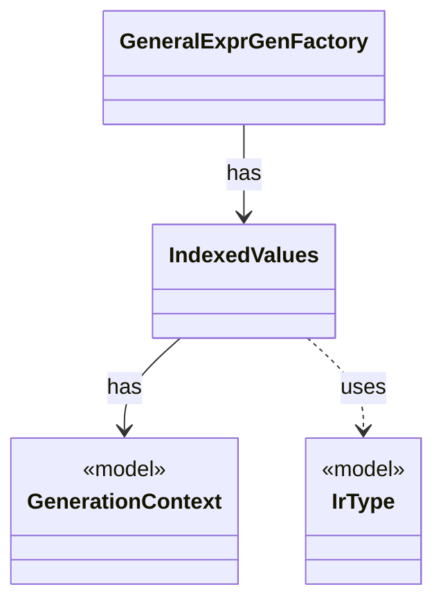

# `IndexedValues`

`io.github.tlaplus.hardening.gen.engine` · class · other · [source](https://github.com/tlaplus/model-checker-hardening/blob/6bbf8b66c375696d1798f7b7a061b81573a3f42a/src/main/java/io/github/tlaplus/hardening/gen/engine/IndexedValues.java#L20) · module [gen](../modules/gen.md)

The byte-free k-th value of a value type, from which collection terminals take distinct elements (ADR 0011).

**Decisions:** [ADR 0011: Collection base size](https://github.com/tlaplus/model-checker-hardening/blob/6bbf8b66c375696d1798f7b7a061b81573a3f42a/docs/decisions/0011-collection-base-size.md)

The diagram draws 3 of 16 relations; the table lists them all.

| Direction | Relation | Type | Summary |
|---|---|---|---|
| → | has | [GenerationContext](io.github.tlaplus.hardening.gen.engine.GenerationContext.md) | Mutable semantic state shared by every component of one generation run. |
| ← | has | [GeneralExprGenFactory](io.github.tlaplus.hardening.gen.engine.GeneralExprGenFactory.md) | Constructs terminal and type-polymorphic expression generators. |
| → | uses | [IrType](io.github.tlaplus.hardening.gen.engine.IrType.md) | Internal type model used to direct checked expression construction. |
| → | depends | [Preconditions](io.github.tlaplus.hardening.common.Preconditions.md) | Shared validation of method and constructor arguments. |
| → | depends | [BuilderArrays](io.github.tlaplus.hardening.gen.engine.BuilderArrays.md) | Array conversions for the builder's generic varargs APIs. |
| → | depends | [ConstantType](io.github.tlaplus.hardening.gen.engine.ConstantType.md) | Model-value type. |
| → | depends | [Field](io.github.tlaplus.hardening.gen.engine.Field.md) | Named component of a record or variant type. |
| → | depends | [FunctionType](io.github.tlaplus.hardening.gen.engine.FunctionType.md) | Function type. |
| → | depends | [OperatorType](io.github.tlaplus.hardening.gen.engine.OperatorType.md) | Operator type. |
| → | depends | [PrimitiveType](io.github.tlaplus.hardening.gen.engine.PrimitiveType.md) | Primitive expression result types. |
| → | depends | [RecordType](io.github.tlaplus.hardening.gen.engine.RecordType.md) | Record type. |
| → | depends | [ScopedName](io.github.tlaplus.hardening.gen.engine.ScopedName.md) | A typed name visible while recursively generating a lexical body. |
| → | depends | [SequenceType](io.github.tlaplus.hardening.gen.engine.SequenceType.md) | Sequence type. |
| → | depends | [SetType](io.github.tlaplus.hardening.gen.engine.SetType.md) | Set type. |
| → | depends | [TupleType](io.github.tlaplus.hardening.gen.engine.TupleType.md) | Tuple type. |
| → | depends | [VariantType](io.github.tlaplus.hardening.gen.engine.VariantType.md) | Variant type. |
