# `IrExprGenFactory`

`io.github.tlaplus.hardening.gen.engine` · class · other · [source](https://github.com/tlaplus/model-checker-hardening/blob/6bbf8b66c375696d1798f7b7a061b81573a3f42a/src/main/java/io/github/tlaplus/hardening/gen/engine/IrExprGenFactory.java#L13) · module [gen](../modules/gen.md)

Factory for deferred, type-directed expression generators within one generation run.

```mermaid
classDiagram
  class IrExprGenFactory
  class ApplicativeExprGenFactory
  class BooleanExprGenFactory
  class ExpressionKind {
    <<interface>>
  }
  class GeneralExprGenFactory
  class GenerationContext {
    <<model>>
  }
  class IntegerExprGenFactory
  class IrType {
    <<model>>
  }
  class IrTypeGenFactory
  class OtherExprGenFactory
  class SequenceExprGenFactory
  class SetExprGenFactory
  class TypeInstantiation {
    <<record>>
  }
  class AbstractExprGenFactory {
    <<contract>>
  }
  class OperandGenerator
  class Generator {
    <<contract>>
  }
  class CustomExpressionKind {
    <<record>>
  }
  class ActionGenFactory
  class ActionShapeGenFactory
  class ModulePrelude
  class PropertyGenFactory
  IrExprGenFactory --> ApplicativeExprGenFactory : has
  IrExprGenFactory --> BooleanExprGenFactory : has
  IrExprGenFactory --> ExpressionKind : has
  IrExprGenFactory --> GeneralExprGenFactory : has
  IrExprGenFactory --> GenerationContext : has
  IrExprGenFactory --> IntegerExprGenFactory : has
  IrExprGenFactory --> IrType : has
  IrExprGenFactory --> IrTypeGenFactory : has
  IrExprGenFactory --> OtherExprGenFactory : has
  IrExprGenFactory --> SequenceExprGenFactory : has
  IrExprGenFactory --> SetExprGenFactory : has
  IrExprGenFactory --> TypeInstantiation : has
  AbstractExprGenFactory --> IrExprGenFactory : has
  OperandGenerator --> IrExprGenFactory : has
  IrExprGenFactory ..> Generator : uses
  IrExprGenFactory ..> CustomExpressionKind : uses
  ActionGenFactory ..> IrExprGenFactory : uses
  ActionShapeGenFactory ..> IrExprGenFactory : uses
  ApplicativeExprGenFactory ..> IrExprGenFactory : uses
  BooleanExprGenFactory ..> IrExprGenFactory : uses
  GeneralExprGenFactory ..> IrExprGenFactory : uses
  IntegerExprGenFactory ..> IrExprGenFactory : uses
  ModulePrelude ..> IrExprGenFactory : uses
  OtherExprGenFactory ..> IrExprGenFactory : uses
  PropertyGenFactory ..> IrExprGenFactory : uses
  SequenceExprGenFactory ..> IrExprGenFactory : uses
  SetExprGenFactory ..> IrExprGenFactory : uses
```

The diagram draws 27 of 51 relations; the table lists them all.

| Direction | Relation | Type | Summary |
|---|---|---|---|
| → | has | [ApplicativeExprGenFactory](io.github.tlaplus.hardening.gen.engine.ApplicativeExprGenFactory.md) | Constructs reads, updates and domains of records, tuples and sequences. |
| → | has | [BooleanExprGenFactory](io.github.tlaplus.hardening.gen.engine.BooleanExprGenFactory.md) | Constructs Boolean-valued expression generators. |
| → | has | [ExpressionKind](io.github.tlaplus.hardening.gen.engine.ExpressionKind.md) | A selectable expression form grouped by the component that constructs it. |
| → | has | [GeneralExprGenFactory](io.github.tlaplus.hardening.gen.engine.GeneralExprGenFactory.md) | Constructs terminal and type-polymorphic expression generators. |
| → | has | [GenerationContext](io.github.tlaplus.hardening.gen.engine.GenerationContext.md) | Mutable semantic state shared by every component of one generation run. |
| → | has | [IntegerExprGenFactory](io.github.tlaplus.hardening.gen.engine.IntegerExprGenFactory.md) | Constructs integer-valued expression generators. |
| → | has | [IrType](io.github.tlaplus.hardening.gen.engine.IrType.md) | Internal type model used to direct checked expression construction. |
| → | has | [IrTypeGenFactory](io.github.tlaplus.hardening.gen.engine.IrTypeGenFactory.md) | Factory for deferred generators of internal types within the configured remaining-depth budget. |
| → | has | [OtherExprGenFactory](io.github.tlaplus.hardening.gen.engine.OtherExprGenFactory.md) | Constructs expression generators not covered by the dedicated form families. |
| → | has | [SequenceExprGenFactory](io.github.tlaplus.hardening.gen.engine.SequenceExprGenFactory.md) | Constructs sequence-valued expression generators. |
| → | has | [SetExprGenFactory](io.github.tlaplus.hardening.gen.engine.SetExprGenFactory.md) | Constructs set-valued expression generators. |
| → | has | [TypeInstantiation](io.github.tlaplus.hardening.gen.engine.TypeInstantiation.md) | Byte-free feasibility analysis followed by bounded, deferred completion of a type term. |
| ← | has | [AbstractExprGenFactory](io.github.tlaplus.hardening.gen.engine.AbstractExprGenFactory.md) | Shared access to the state and recursive factories used by expression generator families. |
| ← | has | [OperandGenerator](io.github.tlaplus.hardening.gen.engine.OperandGenerator.md) | Draws expressions for a rewrite that leaves an operand open (ADR 0017 §3), and for the parameters of an edge guard of a graph module (ADR 0023 §6): an operand is drawn by the ordinary expression factory, at its type, in the lexical scope of the rewritten node or the edge, and in the state-level context, so an operand adds no prime. |
| → | uses | [Generator](io.github.tlaplus.hardening.gen.Generator.md) | A composable recipe for decoding a value from a shared `Draw` cursor. |
| → | uses | [CustomExpressionKind](io.github.tlaplus.hardening.gen.engine.CustomExpressionKind.md) | One configured operator kind; its type scheme comes from the immutable prepared library. |
| ← | uses | [ActionGenFactory](io.github.tlaplus.hardening.gen.engine.ActionGenFactory.md) | Module-level action assembly: Init, operator definitions, bounded parameters, guards, Next and the unconditional step update. |
| ← | uses | [ActionShapeGenFactory](io.github.tlaplus.hardening.gen.engine.ActionShapeGenFactory.md) | Recursive, complete action shapes. |
| ← | uses | [ApplicativeExprGenFactory](io.github.tlaplus.hardening.gen.engine.ApplicativeExprGenFactory.md) | Constructs reads, updates and domains of records, tuples and sequences. |
| ← | uses | [BooleanExprGenFactory](io.github.tlaplus.hardening.gen.engine.BooleanExprGenFactory.md) | Constructs Boolean-valued expression generators. |
| ← | uses | [GeneralExprGenFactory](io.github.tlaplus.hardening.gen.engine.GeneralExprGenFactory.md) | Constructs terminal and type-polymorphic expression generators. |
| ← | uses | [IntegerExprGenFactory](io.github.tlaplus.hardening.gen.engine.IntegerExprGenFactory.md) | Constructs integer-valued expression generators. |
| ← | uses | [ModulePrelude](io.github.tlaplus.hardening.gen.engine.ModulePrelude.md) | The declarations every generated module begins with: its state variables and its state-free auxiliary definitions. |
| ← | uses | [OtherExprGenFactory](io.github.tlaplus.hardening.gen.engine.OtherExprGenFactory.md) | Constructs expression generators not covered by the dedicated form families. |
| ← | uses | [PropertyGenFactory](io.github.tlaplus.hardening.gen.engine.PropertyGenFactory.md) | Module-level temporal property: the property formula and its fairness conditions. |
| ← | uses | [SequenceExprGenFactory](io.github.tlaplus.hardening.gen.engine.SequenceExprGenFactory.md) | Constructs sequence-valued expression generators. |
| ← | uses | [SetExprGenFactory](io.github.tlaplus.hardening.gen.engine.SetExprGenFactory.md) | Constructs set-valued expression generators. |
| → | depends | [Draw](io.github.tlaplus.hardening.gen.Draw.md) | A forward-only deterministic cursor that decodes structured choices from an unstructured byte array. |
| → | depends | [InputRejectedException](io.github.tlaplus.hardening.gen.InputRejectedException.md) | Indicates that the current input cannot be decoded into a valid value. |
| → | depends | [IrGenerationConfig](io.github.tlaplus.hardening.gen.IrGenerationConfig.md) | Settings for generated TLA+ expressions and modules. |
| → | depends | [ApplicativeExpressionKind](io.github.tlaplus.hardening.gen.engine.ApplicativeExpressionKind.md) | Reads, updates and domains of records, tuples and sequences. |
| → | depends | [BooleanExpressionKind](io.github.tlaplus.hardening.gen.engine.BooleanExpressionKind.md) | Boolean-valued expression forms. |
| → | depends | [ExpressionKindCatalog](io.github.tlaplus.hardening.gen.engine.ExpressionKindCatalog.md) | The catalog of every expression form, in decoder order. |
| → | depends | [GeneralExpressionKind](io.github.tlaplus.hardening.gen.engine.GeneralExpressionKind.md) | Type-polymorphic and terminal expression forms. |
| → | depends | [ImportedTypes](io.github.tlaplus.hardening.gen.engine.ImportedTypes.md) | Converts concrete imported type terms at the private generator boundary. |
| → | depends | [IntegerExpressionKind](io.github.tlaplus.hardening.gen.engine.IntegerExpressionKind.md) | Integer-valued expression forms. |
| → | depends | [Level](io.github.tlaplus.hardening.gen.engine.Level.md) | The TLA+ level of the formula an expression form builds, as Specifying Systems defines it and SANY checks it. |
| → | depends | [LevelContext](io.github.tlaplus.hardening.gen.engine.LevelContext.md) | The levels an expression request may produce, which `GenerationContext` keeps as a dynamic ceiling while a body is drawn. |
| → | depends | [OtherExpressionKind](io.github.tlaplus.hardening.gen.engine.OtherExpressionKind.md) | Expression forms not covered by the dedicated type and general families. |
| → | depends | [SequenceExpressionKind](io.github.tlaplus.hardening.gen.engine.SequenceExpressionKind.md) | Sequence-valued expression forms. |
| → | depends | [SequenceType](io.github.tlaplus.hardening.gen.engine.SequenceType.md) | Sequence type. |
| → | depends | [SetExpressionKind](io.github.tlaplus.hardening.gen.engine.SetExpressionKind.md) | Set-valued expression forms. |
| → | depends | [SetType](io.github.tlaplus.hardening.gen.engine.SetType.md) | Set type. |
| → | depends | [TemporalActionExpressionKind](io.github.tlaplus.hardening.gen.engine.TemporalActionExpressionKind.md) | The temporal formulas over an action that Specifying Systems defines: an action occurs in a temporal formula only through them and through fairness. |
| → | depends | [OperatorId](io.github.tlaplus.hardening.gen.library.OperatorId.md) | Case-sensitive identity of an exported operator, independent of its generated name. |
| → | depends | [OperatorLibrary](io.github.tlaplus.hardening.gen.library.OperatorLibrary.md) | Immutable prepared library. |
| ← | depends | [ExpressionKindCatalog](io.github.tlaplus.hardening.gen.engine.ExpressionKindCatalog.md) | The catalog of every expression form, in decoder order. |
| ← | depends | [IrGeneratorEngine](io.github.tlaplus.hardening.gen.engine.IrGeneratorEngine.md) | Reusable coordinator for type-directed IR-expression generation. |
| ← | depends | [IrGraphGeneratorEngine](io.github.tlaplus.hardening.gen.engine.IrGraphGeneratorEngine.md) | Reusable decoder of graph inputs (ADR 0023 §2, §3): a control graph whose nodes carry assignment-only actions, tracked by the variable `pc`, and the invariant `pc /= k`. |
| ← | depends | [IrSpecGeneratorEngine](io.github.tlaplus.hardening.gen.engine.IrSpecGeneratorEngine.md) | Reusable coordinator for generating the declarations of one TLA+ module. |
| ← | depends | [IrTypeGenFactory](io.github.tlaplus.hardening.gen.engine.IrTypeGenFactory.md) | Factory for deferred generators of internal types within the configured remaining-depth budget. |
