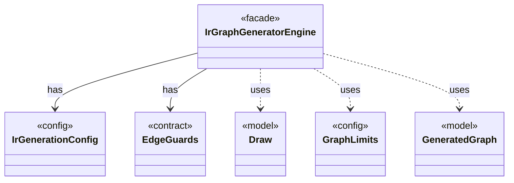

# `IrGraphGeneratorEngine`

`io.github.tlaplus.hardening.gen.engine` · class · facade · key · [source](https://github.com/tlaplus/model-checker-hardening/blob/4df6a11e5b4bf93609393935c4cbeceec08cce0c/src/main/java/io/github/tlaplus/hardening/gen/engine/IrGraphGeneratorEngine.java#L58) · module [gen](../modules/gen.md)

Reusable decoder of graph inputs (ADR 0023 §2, §3): a control graph whose nodes carry assignment-only actions, tracked by the variable `pc`, and the invariant `pc /= k`.

**Decisions:** [ADR 0023: Graph-based testing](https://github.com/tlaplus/model-checker-hardening/blob/4df6a11e5b4bf93609393935c4cbeceec08cce0c/docs/decisions/0023-graph-based-testing.md)

The diagram draws 5 of 32 relations; the table lists them all.

| Direction | Relation | Type | Summary |
|---|---|---|---|
| → | has | [IrGenerationConfig](io.github.tlaplus.hardening.gen.IrGenerationConfig.md) | Settings for generated TLA+ expressions and modules. |
| → | has | [EdgeGuards](io.github.tlaplus.hardening.gen.engine.EdgeGuards.md) | Draws the tautological guards that a graph module conjoins to its edges (ADR 0023 §6). |
| → | uses | [Draw](io.github.tlaplus.hardening.gen.Draw.md) | A forward-only deterministic cursor that decodes structured choices from an unstructured byte array. |
| → | uses | [GraphLimits](io.github.tlaplus.hardening.gen.GraphLimits.md) | Bounds on the control graph of one graph input (ADR 0023 §3). |
| → | uses | [GeneratedGraph](io.github.tlaplus.hardening.gen.graph.GeneratedGraph.md) | A module decoded from a graph input (ADR 0023 §2), with the graph it encodes and the target its invariant `pc /= target` names. |
| → | depends | [ActionEffect](io.github.tlaplus.hardening.gen.ActionEffect.md) | Nonempty, duplicate-free effect in variable declaration order, with set-style identity. |
| → | depends | [BasicGenerators](io.github.tlaplus.hardening.gen.BasicGenerators.md) | Factory methods for basic generators that compose through a shared `Draw`. |
| → | depends | [ExpressionLimits](io.github.tlaplus.hardening.gen.ExpressionLimits.md) | Bounds on recursive construction and variable-size payloads within one expression. |
| → | depends | [GeneratedActionOperator](io.github.tlaplus.hardening.gen.GeneratedActionOperator.md) | One generated action operator: a definition the next-state action may apply. |
| → | depends | [GeneratedOperator](io.github.tlaplus.hardening.gen.GeneratedOperator.md) | A generated definition, stored once in module declaration order. |
| → | depends | [GeneratedSpec](io.github.tlaplus.hardening.gen.GeneratedSpec.md) | The declarations one generated module consists of. |
| → | depends | [Generator](io.github.tlaplus.hardening.gen.Generator.md) | A composable recipe for decoding a value from a shared `Draw` cursor. |
| → | depends | [ModuleLimits](io.github.tlaplus.hardening.gen.ModuleLimits.md) | Declaration, action and exploration bounds on one module. |
| → | depends | [ActionGenFactory](io.github.tlaplus.hardening.gen.engine.ActionGenFactory.md) | Module-level action assembly: Init, operator definitions, bounded parameters, guards, Next and the unconditional step update. |
| → | depends | [ActionShapeGenFactory](io.github.tlaplus.hardening.gen.engine.ActionShapeGenFactory.md) | Recursive, complete action shapes. |
| → | depends | [BuilderArrays](io.github.tlaplus.hardening.gen.engine.BuilderArrays.md) | Array conversions for the builder's generic varargs APIs. |
| → | depends | [CustomExpressionKind](io.github.tlaplus.hardening.gen.engine.CustomExpressionKind.md) | One configured operator kind; its type scheme comes from the immutable prepared library. |
| → | depends | [ExpressionKindCatalog](io.github.tlaplus.hardening.gen.engine.ExpressionKindCatalog.md) | The catalog of every expression form, in decoder order. |
| → | depends | [GenerationContext](io.github.tlaplus.hardening.gen.engine.GenerationContext.md) | Mutable semantic state shared by every component of one generation run. |
| → | depends | [GraphSection](io.github.tlaplus.hardening.gen.engine.GraphSection.md) | The independent parts of a graph input after its header, each decoded from its own contiguous range of bytes (ADR 0023 §3), as `ModuleSection` does for a module input. |
| → | depends | [IrExprGenFactory](io.github.tlaplus.hardening.gen.engine.IrExprGenFactory.md) | Factory for deferred, type-directed expression generators within one generation run. |
| → | depends | [IrType](io.github.tlaplus.hardening.gen.engine.IrType.md) | Internal type model used to direct checked expression construction. |
| → | depends | [IrTypeGenFactory](io.github.tlaplus.hardening.gen.engine.IrTypeGenFactory.md) | Factory for deferred generators of internal types within the configured remaining-depth budget. |
| → | depends | [ModulePrelude](io.github.tlaplus.hardening.gen.engine.ModulePrelude.md) | The declarations every generated module begins with: its state variables and its state-free auxiliary definitions. |
| → | depends | [OperandGenerator](io.github.tlaplus.hardening.gen.engine.OperandGenerator.md) | Draws expressions for a rewrite that leaves an operand open (ADR 0017 §3), and for the parameters of an edge guard of a graph module (ADR 0023 §6): an operand is drawn by the ordinary expression factory, at its type, in the lexical scope of the rewritten node or the edge, and in the state-level context, so an operand adds no prime. |
| → | depends | [OperatorType](io.github.tlaplus.hardening.gen.engine.OperatorType.md) | Operator type. |
| → | depends | [PrimitiveType](io.github.tlaplus.hardening.gen.engine.PrimitiveType.md) | Primitive expression result types. |
| → | depends | [ScopedName](io.github.tlaplus.hardening.gen.engine.ScopedName.md) | A typed name visible while recursively generating a lexical body. |
| → | depends | [WeightedSlices](io.github.tlaplus.hardening.gen.engine.WeightedSlices.md) | Divides the remaining bytes of a cursor into contiguous slices of proportional length. |
| → | depends | [TransitionGraph](io.github.tlaplus.hardening.gen.graph.TransitionGraph.md) | A directed graph over the nodes `0..N-1`, the control structure of a graph module (ADR 0023 §2). |
| → | depends | [IrNames](io.github.tlaplus.hardening.gen.ir.IrNames.md) | Names in typed IR: injective renaming and the names an expression reads from its context. |
| ← | depends | [IrGenerators](io.github.tlaplus.hardening.gen.IrGenerators.md) | Factory methods for deterministic generators of type-checked Apalache IR expressions. |
