# `IrType`

`io.github.tlaplus.hardening.gen.engine` · interface · model · key · [source](https://github.com/tlaplus/model-checker-hardening/blob/af09a9e32eb710979ef0c76f29507ce1ffe85a15/src/main/java/io/github/tlaplus/hardening/gen/engine/IrType.java#L13) · module [gen](../modules/gen.md)

Internal type model used to direct checked expression construction.

```mermaid
classDiagram
  class IrType {
    <<model>>
  }
  class ConstantType {
    <<record>>
  }
  class FunctionType {
    <<record>>
  }
  class OperatorType {
    <<record>>
  }
  class PrimitiveType {
    <<enum>>
  }
  class RecordType {
    <<record>>
  }
  class SequenceType {
    <<record>>
  }
  class SetType {
    <<record>>
  }
  class TupleType {
    <<record>>
  }
  class VariantType {
    <<record>>
  }
  class Field {
    <<record>>
  }
  class GenerationContext {
    <<model>>
  }
  class IrExprGenFactory
  class IrTypeGenFactory
  class ScopedName {
    <<record>>
  }
  class AbstractExprGenFactory {
    <<contract>>
  }
  class ActionShapeGenFactory
  class ApplicativeExprGenFactory
  class ApplicativeExpressionKind {
    <<enum>>
  }
  class BooleanExpressionKind {
    <<enum>>
  }
  class CustomExpressionKind {
    <<record>>
  }
  class ExpressionKind {
    <<interface>>
  }
  class GeneralExprGenFactory
  class GeneralExpressionKind {
    <<enum>>
  }
  class ImportedTypes
  class IndexedValues
  class IntegerExpressionKind {
    <<enum>>
  }
  class NameScope
  class OtherExprGenFactory
  class OtherExpressionKind {
    <<enum>>
  }
  class SequenceExpressionKind {
    <<enum>>
  }
  IrType <|.. ConstantType
  IrType <|.. FunctionType
  IrType <|.. OperatorType
  IrType <|.. PrimitiveType
  IrType <|.. RecordType
  IrType <|.. SequenceType
  IrType <|.. SetType
  IrType <|.. TupleType
  IrType <|.. VariantType
  Field --> IrType : has
  GenerationContext --> IrType : has
  IrExprGenFactory --> IrType : has
  IrTypeGenFactory --> IrType : has
  ScopedName --> IrType : has
  AbstractExprGenFactory ..> IrType : uses
  ActionShapeGenFactory ..> IrType : uses
  ApplicativeExprGenFactory ..> IrType : uses
  ApplicativeExpressionKind ..> IrType : uses
  BooleanExpressionKind ..> IrType : uses
  CustomExpressionKind ..> IrType : uses
  ExpressionKind ..> IrType : uses
  GeneralExprGenFactory ..> IrType : uses
  GeneralExpressionKind ..> IrType : uses
  ImportedTypes ..> IrType : uses
  IndexedValues ..> IrType : uses
  IntegerExpressionKind ..> IrType : uses
  NameScope ..> IrType : uses
  OtherExprGenFactory ..> IrType : uses
  OtherExpressionKind ..> IrType : uses
  SequenceExpressionKind ..> IrType : uses
```

The diagram draws 30 of 53 relations; the table lists them all.

| Direction | Relation | Type | Summary |
|---|---|---|---|
| ← | implements | [ConstantType](io.github.tlaplus.hardening.gen.engine.ConstantType.md) | Model-value type. |
| ← | implements | [FunctionType](io.github.tlaplus.hardening.gen.engine.FunctionType.md) | Function type. |
| ← | implements | [OperatorType](io.github.tlaplus.hardening.gen.engine.OperatorType.md) | Operator type. |
| ← | implements | [PrimitiveType](io.github.tlaplus.hardening.gen.engine.PrimitiveType.md) | Primitive expression result types. |
| ← | implements | [RecordType](io.github.tlaplus.hardening.gen.engine.RecordType.md) | Record type. |
| ← | implements | [SequenceType](io.github.tlaplus.hardening.gen.engine.SequenceType.md) | Sequence type. |
| ← | implements | [SetType](io.github.tlaplus.hardening.gen.engine.SetType.md) | Set type. |
| ← | implements | [TupleType](io.github.tlaplus.hardening.gen.engine.TupleType.md) | Tuple type. |
| ← | implements | [VariantType](io.github.tlaplus.hardening.gen.engine.VariantType.md) | Variant type. |
| ← | has | [Field](io.github.tlaplus.hardening.gen.engine.Field.md) | Named component of a record or variant type. |
| ← | has | [GenerationContext](io.github.tlaplus.hardening.gen.engine.GenerationContext.md) | Mutable semantic state shared by every component of one generation run. |
| ← | has | [IrExprGenFactory](io.github.tlaplus.hardening.gen.engine.IrExprGenFactory.md) | Factory for deferred, type-directed expression generators within one generation run. |
| ← | has | [IrTypeGenFactory](io.github.tlaplus.hardening.gen.engine.IrTypeGenFactory.md) | Factory for deferred generators of internal types within the configured remaining-depth budget. |
| ← | has | [ScopedName](io.github.tlaplus.hardening.gen.engine.ScopedName.md) | A typed name visible while recursively generating a lexical body. |
| ← | uses | [AbstractExprGenFactory](io.github.tlaplus.hardening.gen.engine.AbstractExprGenFactory.md) | Shared access to the state and recursive factories used by expression generator families. |
| ← | uses | [ActionShapeGenFactory](io.github.tlaplus.hardening.gen.engine.ActionShapeGenFactory.md) | Recursive, complete action shapes. |
| ← | uses | [ApplicativeExprGenFactory](io.github.tlaplus.hardening.gen.engine.ApplicativeExprGenFactory.md) | Constructs reads, updates and domains of records, tuples and sequences. |
| ← | uses | [ApplicativeExpressionKind](io.github.tlaplus.hardening.gen.engine.ApplicativeExpressionKind.md) | Reads, updates and domains of records, tuples and sequences. |
| ← | uses | [BooleanExpressionKind](io.github.tlaplus.hardening.gen.engine.BooleanExpressionKind.md) | Boolean-valued expression forms. |
| ← | uses | [CustomExpressionKind](io.github.tlaplus.hardening.gen.engine.CustomExpressionKind.md) | One configured operator kind; its type scheme comes from the immutable prepared library. |
| ← | uses | [ExpressionKind](io.github.tlaplus.hardening.gen.engine.ExpressionKind.md) | A selectable expression form grouped by the component that constructs it. |
| ← | uses | [GeneralExprGenFactory](io.github.tlaplus.hardening.gen.engine.GeneralExprGenFactory.md) | Constructs terminal and type-polymorphic expression generators. |
| ← | uses | [GeneralExpressionKind](io.github.tlaplus.hardening.gen.engine.GeneralExpressionKind.md) | Type-polymorphic and terminal expression forms. |
| ← | uses | [ImportedTypes](io.github.tlaplus.hardening.gen.engine.ImportedTypes.md) | Converts concrete imported type terms at the private generator boundary. |
| ← | uses | [IndexedValues](io.github.tlaplus.hardening.gen.engine.IndexedValues.md) | The byte-free k-th value of a value type, from which collection terminals take distinct elements (ADR 0011). |
| ← | uses | [IntegerExpressionKind](io.github.tlaplus.hardening.gen.engine.IntegerExpressionKind.md) | Integer-valued expression forms. |
| ← | uses | [NameScope](io.github.tlaplus.hardening.gen.engine.NameScope.md) | Exception-safe dynamic view over a persistent lexical-scope list. |
| ← | uses | [OtherExprGenFactory](io.github.tlaplus.hardening.gen.engine.OtherExprGenFactory.md) | Constructs expression generators not covered by the dedicated form families. |
| ← | uses | [OtherExpressionKind](io.github.tlaplus.hardening.gen.engine.OtherExpressionKind.md) | Expression forms not covered by the dedicated type and general families. |
| ← | uses | [SequenceExpressionKind](io.github.tlaplus.hardening.gen.engine.SequenceExpressionKind.md) | Sequence-valued expression forms. |
| ← | uses | [SetExpressionKind](io.github.tlaplus.hardening.gen.engine.SetExpressionKind.md) | Set-valued expression forms. |
| ← | uses | [TemporalActionExpressionKind](io.github.tlaplus.hardening.gen.engine.TemporalActionExpressionKind.md) | The temporal formulas over an action that Specifying Systems defines: an action occurs in a temporal formula only through them and through fairness. |
| → | depends | [ConstantType](io.github.tlaplus.hardening.gen.engine.ConstantType.md) | Model-value type. |
| → | depends | [FunctionType](io.github.tlaplus.hardening.gen.engine.FunctionType.md) | Function type. |
| → | depends | [OperatorType](io.github.tlaplus.hardening.gen.engine.OperatorType.md) | Operator type. |
| → | depends | [PrimitiveType](io.github.tlaplus.hardening.gen.engine.PrimitiveType.md) | Primitive expression result types. |
| → | depends | [RecordType](io.github.tlaplus.hardening.gen.engine.RecordType.md) | Record type. |
| → | depends | [SequenceType](io.github.tlaplus.hardening.gen.engine.SequenceType.md) | Sequence type. |
| → | depends | [SetType](io.github.tlaplus.hardening.gen.engine.SetType.md) | Set type. |
| → | depends | [TupleType](io.github.tlaplus.hardening.gen.engine.TupleType.md) | Tuple type. |
| → | depends | [VariantType](io.github.tlaplus.hardening.gen.engine.VariantType.md) | Variant type. |
| ← | depends | [ActionGenFactory](io.github.tlaplus.hardening.gen.engine.ActionGenFactory.md) | Module-level action assembly: Init, operator definitions, bounded parameters, guards, Next and the unconditional step update. |
| ← | depends | [BooleanExprGenFactory](io.github.tlaplus.hardening.gen.engine.BooleanExprGenFactory.md) | Constructs Boolean-valued expression generators. |
| ← | depends | [IntegerExprGenFactory](io.github.tlaplus.hardening.gen.engine.IntegerExprGenFactory.md) | Constructs integer-valued expression generators. |
| ← | depends | [IrGeneratorEngine](io.github.tlaplus.hardening.gen.engine.IrGeneratorEngine.md) | Reusable coordinator for type-directed IR-expression generation. |
| ← | depends | [IrGraphGeneratorEngine](io.github.tlaplus.hardening.gen.engine.IrGraphGeneratorEngine.md) | Reusable decoder of graph inputs (ADR 0023 §2, §3): a control graph whose nodes carry assignment-only actions, tracked by the variable `pc`, and the invariant `pc /= k`. |
| ← | depends | [IrSpecGeneratorEngine](io.github.tlaplus.hardening.gen.engine.IrSpecGeneratorEngine.md) | Reusable coordinator for generating the declarations of one TLA+ module. |
| ← | depends | [ModulePrelude](io.github.tlaplus.hardening.gen.engine.ModulePrelude.md) | The declarations every generated module begins with: its state variables and its state-free auxiliary definitions. |
| ← | depends | [OperandGenerator](io.github.tlaplus.hardening.gen.engine.OperandGenerator.md) | Draws expressions for a rewrite that leaves an operand open (ADR 0017 §3), and for the parameters of an edge guard of a graph module (ADR 0023 §6): an operand is drawn by the ordinary expression factory, at its type, in the lexical scope of the rewritten node or the edge, and in the state-level context, so an operand adds no prime. |
| ← | depends | [PropertyGenFactory](io.github.tlaplus.hardening.gen.engine.PropertyGenFactory.md) | Module-level temporal property: the property formula and its fairness conditions. |
| ← | depends | [SequenceExprGenFactory](io.github.tlaplus.hardening.gen.engine.SequenceExprGenFactory.md) | Constructs sequence-valued expression generators. |
| ← | depends | [SetExprGenFactory](io.github.tlaplus.hardening.gen.engine.SetExprGenFactory.md) | Constructs set-valued expression generators. |
| ← | depends | [TypeInstantiation](io.github.tlaplus.hardening.gen.engine.TypeInstantiation.md) | Byte-free feasibility analysis followed by bounded, deferred completion of a type term. |
