# `IrTypeGenFactory`

`io.github.tlaplus.hardening.gen.engine` · class · other · [source](https://github.com/tlaplus/model-checker-hardening/blob/3b201567990514c2a43b90dca521dbe32af37023/src/main/java/io/github/tlaplus/hardening/gen/engine/IrTypeGenFactory.java#L26) · module [gen](../modules/gen.md)

Factory for deferred generators of internal types within the configured remaining-depth budget.

```mermaid
classDiagram
  class IrTypeGenFactory
  class GenerationContext {
    <<model>>
  }
  class IrType {
    <<model>>
  }
  class TypeInstantiation {
    <<record>>
  }
  class AbstractExprGenFactory {
    <<contract>>
  }
  class IrExprGenFactory
  class OperandGenerator
  class ExpressionCategory {
    <<enum>>
  }
  class Generator {
    <<contract>>
  }
  class TaggedVariant {
    <<record>>
  }
  class VariantType {
    <<record>>
  }
  class ActionGenFactory
  class ActionShapeGenFactory
  class ApplicativeExprGenFactory
  class BooleanExprGenFactory
  class GeneralExprGenFactory
  class IntegerExprGenFactory
  class ModulePrelude
  class OtherExprGenFactory
  class PropertyGenFactory
  class SequenceExprGenFactory
  class SetExprGenFactory
  IrTypeGenFactory --> GenerationContext : has
  IrTypeGenFactory --> IrType : has
  IrTypeGenFactory --> TypeInstantiation : has
  AbstractExprGenFactory --> IrTypeGenFactory : has
  IrExprGenFactory --> IrTypeGenFactory : has
  OperandGenerator --> IrTypeGenFactory : has
  IrTypeGenFactory ..> ExpressionCategory : uses
  IrTypeGenFactory ..> Generator : uses
  IrTypeGenFactory ..> TaggedVariant : uses
  IrTypeGenFactory ..> VariantType : uses
  ActionGenFactory ..> IrTypeGenFactory : uses
  ActionShapeGenFactory ..> IrTypeGenFactory : uses
  ApplicativeExprGenFactory ..> IrTypeGenFactory : uses
  BooleanExprGenFactory ..> IrTypeGenFactory : uses
  GeneralExprGenFactory ..> IrTypeGenFactory : uses
  IntegerExprGenFactory ..> IrTypeGenFactory : uses
  ModulePrelude ..> IrTypeGenFactory : uses
  OtherExprGenFactory ..> IrTypeGenFactory : uses
  PropertyGenFactory ..> IrTypeGenFactory : uses
  SequenceExprGenFactory ..> IrTypeGenFactory : uses
  SetExprGenFactory ..> IrTypeGenFactory : uses
  TypeInstantiation ..> IrTypeGenFactory : uses
```

The diagram draws 22 of 44 relations; the table lists them all.

| Direction | Relation | Type | Summary |
|---|---|---|---|
| → | has | [GenerationContext](io.github.tlaplus.hardening.gen.engine.GenerationContext.md) | Mutable semantic state shared by every component of one generation run. |
| → | has | [IrType](io.github.tlaplus.hardening.gen.engine.IrType.md) | Internal type model used to direct checked expression construction. |
| → | has | [TypeInstantiation](io.github.tlaplus.hardening.gen.engine.TypeInstantiation.md) | Byte-free feasibility analysis followed by bounded, deferred completion of a type term. |
| ← | has | [AbstractExprGenFactory](io.github.tlaplus.hardening.gen.engine.AbstractExprGenFactory.md) | Shared access to the state and recursive factories used by expression generator families. |
| ← | has | [IrExprGenFactory](io.github.tlaplus.hardening.gen.engine.IrExprGenFactory.md) | Factory for deferred, type-directed expression generators within one generation run. |
| ← | has | [OperandGenerator](io.github.tlaplus.hardening.gen.engine.OperandGenerator.md) | Draws expressions for a rewrite that leaves an operand open (ADR 0017 §3), and for the parameters of an edge guard of a graph module (ADR 0023 §6): an operand is drawn by the ordinary expression factory, at its type, in the lexical scope of the rewritten node or the edge, and in the state-level context, so an operand adds no prime. |
| → | uses | [ExpressionCategory](io.github.tlaplus.hardening.gen.ExpressionCategory.md) | A user-facing category assigned to generated expression forms. |
| → | uses | [Generator](io.github.tlaplus.hardening.gen.Generator.md) | A composable recipe for decoding a value from a shared `Draw` cursor. |
| → | uses | [TaggedVariant](io.github.tlaplus.hardening.gen.engine.TaggedVariant.md) | A variant type with one of its tags selected, such as the tag whose payload a read extracts. |
| → | uses | [VariantType](io.github.tlaplus.hardening.gen.engine.VariantType.md) | Variant type. |
| ← | uses | [ActionGenFactory](io.github.tlaplus.hardening.gen.engine.ActionGenFactory.md) | Module-level action assembly: Init, operator definitions, bounded parameters, guards, Next and the unconditional step update. |
| ← | uses | [ActionShapeGenFactory](io.github.tlaplus.hardening.gen.engine.ActionShapeGenFactory.md) | Recursive, complete action shapes. |
| ← | uses | [ApplicativeExprGenFactory](io.github.tlaplus.hardening.gen.engine.ApplicativeExprGenFactory.md) | Constructs reads, updates and domains of records, tuples and sequences. |
| ← | uses | [BooleanExprGenFactory](io.github.tlaplus.hardening.gen.engine.BooleanExprGenFactory.md) | Constructs Boolean-valued expression generators. |
| ← | uses | [GeneralExprGenFactory](io.github.tlaplus.hardening.gen.engine.GeneralExprGenFactory.md) | Constructs terminal and type-polymorphic expression generators. |
| ← | uses | [IntegerExprGenFactory](io.github.tlaplus.hardening.gen.engine.IntegerExprGenFactory.md) | Constructs integer-valued expression generators. |
| ← | uses | [ModulePrelude](io.github.tlaplus.hardening.gen.engine.ModulePrelude.md) | The declarations every generated module begins with: its state variables and its state-free auxiliary definitions. |
| ← | uses | [OtherExprGenFactory](io.github.tlaplus.hardening.gen.engine.OtherExprGenFactory.md) | Constructs expression generators not covered by the dedicated form families. |
| ← | uses | [PropertyGenFactory](io.github.tlaplus.hardening.gen.engine.PropertyGenFactory.md) | Module-level temporal property: the property formula and its fairness conditions. |
| ← | uses | [SequenceExprGenFactory](io.github.tlaplus.hardening.gen.engine.SequenceExprGenFactory.md) | Constructs sequence-valued expression generators. |
| ← | uses | [SetExprGenFactory](io.github.tlaplus.hardening.gen.engine.SetExprGenFactory.md) | Constructs set-valued expression generators. |
| ← | uses | [TypeInstantiation](io.github.tlaplus.hardening.gen.engine.TypeInstantiation.md) | Byte-free feasibility analysis followed by bounded, deferred completion of a type term. |
| → | depends | [BasicGenerators](io.github.tlaplus.hardening.gen.BasicGenerators.md) | Factory methods for basic generators that compose through a shared `Draw`. |
| → | depends | [CollectionLimits](io.github.tlaplus.hardening.gen.CollectionLimits.md) | Sizes of generated collection values (ADR 0011). |
| → | depends | [Draw](io.github.tlaplus.hardening.gen.Draw.md) | A forward-only deterministic cursor that decodes structured choices from an unstructured byte array. |
| → | depends | [ExpressionLimits](io.github.tlaplus.hardening.gen.ExpressionLimits.md) | Bounds on recursive construction and variable-size payloads within one expression. |
| → | depends | [IrGenerationConfig](io.github.tlaplus.hardening.gen.IrGenerationConfig.md) | Settings for generated TLA+ expressions and modules. |
| → | depends | [ConstantType](io.github.tlaplus.hardening.gen.engine.ConstantType.md) | Model-value type. |
| → | depends | [ExpressionKind](io.github.tlaplus.hardening.gen.engine.ExpressionKind.md) | A selectable expression form grouped by the component that constructs it. |
| → | depends | [Field](io.github.tlaplus.hardening.gen.engine.Field.md) | Named component of a record or variant type. |
| → | depends | [FunctionType](io.github.tlaplus.hardening.gen.engine.FunctionType.md) | Function type. |
| → | depends | [ImportedTypes](io.github.tlaplus.hardening.gen.engine.ImportedTypes.md) | Converts concrete imported type terms at the private generator boundary. |
| → | depends | [IrExprGenFactory](io.github.tlaplus.hardening.gen.engine.IrExprGenFactory.md) | Factory for deferred, type-directed expression generators within one generation run. |
| → | depends | [OperatorType](io.github.tlaplus.hardening.gen.engine.OperatorType.md) | Operator type. |
| → | depends | [PrimitiveType](io.github.tlaplus.hardening.gen.engine.PrimitiveType.md) | Primitive expression result types. |
| → | depends | [RecordType](io.github.tlaplus.hardening.gen.engine.RecordType.md) | Record type. |
| → | depends | [SequenceType](io.github.tlaplus.hardening.gen.engine.SequenceType.md) | Sequence type. |
| → | depends | [SetType](io.github.tlaplus.hardening.gen.engine.SetType.md) | Set type. |
| → | depends | [TupleType](io.github.tlaplus.hardening.gen.engine.TupleType.md) | Tuple type. |
| → | depends | [LibraryTypes](io.github.tlaplus.hardening.gen.library.LibraryTypes.md) | Structural inspection of imported type terms, including row variables. |
| → | depends | [OperatorLibrary](io.github.tlaplus.hardening.gen.library.OperatorLibrary.md) | Immutable prepared library. |
| ← | depends | [IrGeneratorEngine](io.github.tlaplus.hardening.gen.engine.IrGeneratorEngine.md) | Reusable coordinator for type-directed IR-expression generation. |
| ← | depends | [IrGraphGeneratorEngine](io.github.tlaplus.hardening.gen.engine.IrGraphGeneratorEngine.md) | Reusable decoder of graph inputs (ADR 0023 §2, §3): a control graph whose nodes carry assignment-only actions, tracked by the variable `pc`, and the invariant `pc /= k`. |
| ← | depends | [IrSpecGeneratorEngine](io.github.tlaplus.hardening.gen.engine.IrSpecGeneratorEngine.md) | Reusable coordinator for generating the declarations of one TLA+ module. |
