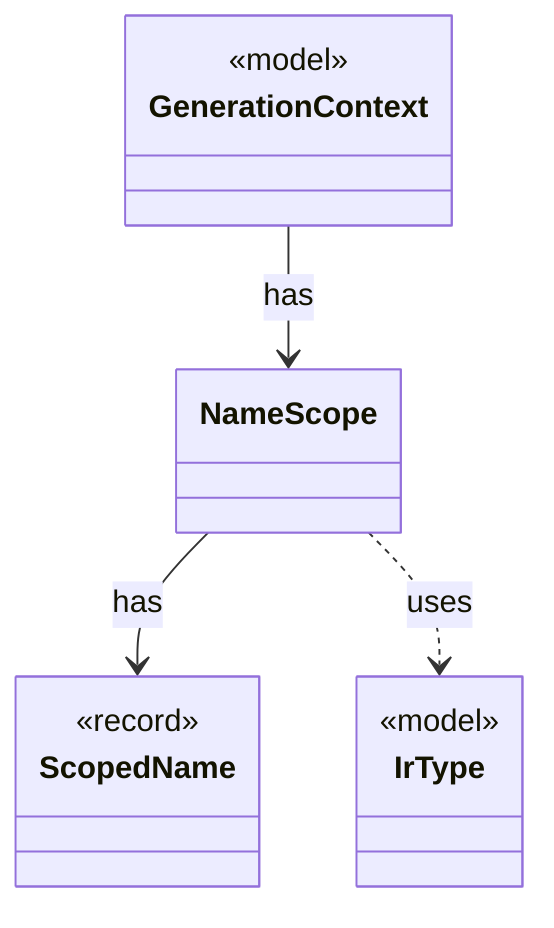

# `NameScope`

`io.github.tlaplus.hardening.gen.engine` · class · other · [source](https://github.com/tlaplus/model-checker-hardening/blob/ed5c97e61582ad2ff90b4ea4209355aa0d555717/src/main/java/io/github/tlaplus/hardening/gen/engine/NameScope.java#L47) · module [gen](../modules/gen.md)

Exception-safe dynamic view over a persistent lexical-scope list.

The diagram draws 3 of 5 relations; the table lists them all.

| Direction | Relation | Type | Summary |
|---|---|---|---|
| → | has | [ScopedName](io.github.tlaplus.hardening.gen.engine.ScopedName.md) | A typed name visible while recursively generating a lexical body. |
| ← | has | [GenerationContext](io.github.tlaplus.hardening.gen.engine.GenerationContext.md) | Mutable semantic state shared by every component of one generation run. |
| → | uses | [IrType](io.github.tlaplus.hardening.gen.engine.IrType.md) | Internal type model used to direct checked expression construction. |
| → | depends | [OperatorType](io.github.tlaplus.hardening.gen.engine.OperatorType.md) | Operator type. |
| → | depends | [ScopedNameKind](io.github.tlaplus.hardening.gen.engine.ScopedNameKind.md) | Semantic role of a name visible during expression generation. |
