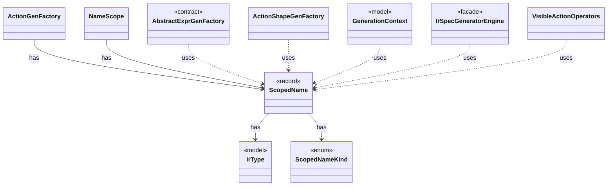

# `ScopedName`

`io.github.tlaplus.hardening.gen.engine` · record · other · [source](https://github.com/tlaplus/model-checker-hardening/blob/3df8c8564b58e946b95079b671788c8315f98831/src/main/java/io/github/tlaplus/hardening/gen/engine/NameScope.java#L23) · module [gen](../modules/gen.md)

A typed name visible while recursively generating a lexical body.

The diagram draws 9 of 13 relations; the table lists them all.

| Direction | Relation | Type | Summary |
|---|---|---|---|
| → | has | [IrType](io.github.tlaplus.hardening.gen.engine.IrType.md) | Internal type model used to direct checked expression construction. |
| → | has | [ScopedNameKind](io.github.tlaplus.hardening.gen.engine.ScopedNameKind.md) | Semantic role of a name visible during expression generation. |
| ← | has | [ActionGenFactory](io.github.tlaplus.hardening.gen.engine.ActionGenFactory.md) | Module-level action assembly: Init, operator definitions, bounded parameters, guards, Next and the unconditional step update. |
| ← | has | [NameScope](io.github.tlaplus.hardening.gen.engine.NameScope.md) | Exception-safe dynamic view over a persistent lexical-scope list. |
| ← | uses | [AbstractExprGenFactory](io.github.tlaplus.hardening.gen.engine.AbstractExprGenFactory.md) | Shared access to the state and recursive factories used by expression generator families. |
| ← | uses | [ActionShapeGenFactory](io.github.tlaplus.hardening.gen.engine.ActionShapeGenFactory.md) | Recursive, complete action shapes. |
| ← | uses | [GenerationContext](io.github.tlaplus.hardening.gen.engine.GenerationContext.md) | Mutable semantic state shared by every component of one generation run. |
| ← | uses | [IrSpecGeneratorEngine](io.github.tlaplus.hardening.gen.engine.IrSpecGeneratorEngine.md) | Reusable coordinator for generating the declarations of one TLA+ module. |
| ← | uses | [VisibleActionOperators](io.github.tlaplus.hardening.gen.engine.VisibleActionOperators.md) | Immutable operator prefix; candidates retain declaration order for byte selection. |
| ← | depends | [BooleanExprGenFactory](io.github.tlaplus.hardening.gen.engine.BooleanExprGenFactory.md) | Constructs Boolean-valued expression generators. |
| ← | depends | [GeneralExprGenFactory](io.github.tlaplus.hardening.gen.engine.GeneralExprGenFactory.md) | Constructs terminal and type-polymorphic expression generators. |
| ← | depends | [IndexedValues](io.github.tlaplus.hardening.gen.engine.IndexedValues.md) | The byte-free k-th value of a value type, from which collection terminals take distinct elements (ADR 0011). |
| ← | depends | [OperandGenerator](io.github.tlaplus.hardening.gen.engine.OperandGenerator.md) | Draws expressions for a rewrite that leaves an operand open (ADR 0017 §3): a fresh parameter is drawn by the ordinary expression factory, at its type, in the lexical scope of the rewritten node, and in the state-level context, so a fresh operand adds no prime. |
