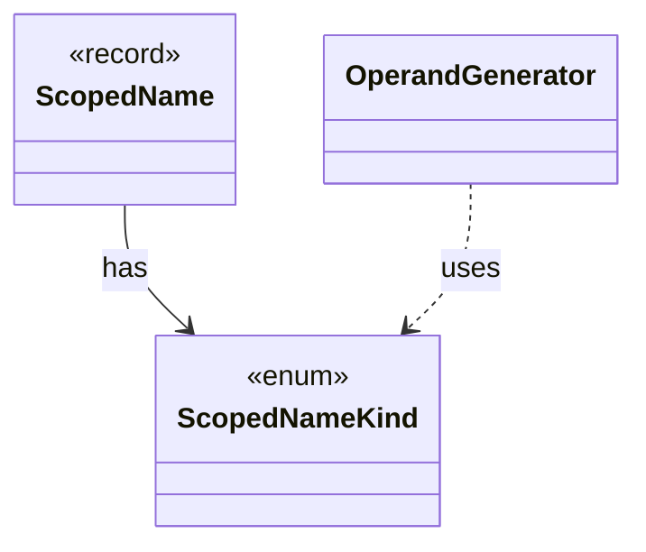

# `ScopedNameKind`

`io.github.tlaplus.hardening.gen.engine` · enum · other · [source](https://github.com/tlaplus/model-checker-hardening/blob/3df8c8564b58e946b95079b671788c8315f98831/src/main/java/io/github/tlaplus/hardening/gen/engine/NameScope.java#L16) · module [gen](../modules/gen.md)

Semantic role of a name visible during expression generation.

The diagram draws 2 of 3 relations; the table lists them all.

| Direction | Relation | Type | Summary |
|---|---|---|---|
| ← | has | [ScopedName](io.github.tlaplus.hardening.gen.engine.ScopedName.md) | A typed name visible while recursively generating a lexical body. |
| ← | uses | [OperandGenerator](io.github.tlaplus.hardening.gen.engine.OperandGenerator.md) | Draws expressions for a rewrite that leaves an operand open (ADR 0017 §3): a fresh parameter is drawn by the ordinary expression factory, at its type, in the lexical scope of the rewritten node, and in the state-level context, so a fresh operand adds no prime. |
| ← | depends | [NameScope](io.github.tlaplus.hardening.gen.engine.NameScope.md) | Exception-safe dynamic view over a persistent lexical-scope list. |
