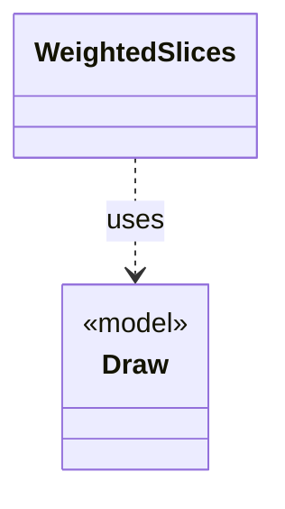

# `WeightedSlices`

`io.github.tlaplus.hardening.gen.engine` · class · other · [source](https://github.com/tlaplus/model-checker-hardening/blob/4df6a11e5b4bf93609393935c4cbeceec08cce0c/src/main/java/io/github/tlaplus/hardening/gen/engine/WeightedSlices.java#L17) · module [gen](../modules/gen.md)

Divides the remaining bytes of a cursor into contiguous slices of proportional length.

The diagram draws 1 of 5 relations; the table lists them all.

| Direction | Relation | Type | Summary |
|---|---|---|---|
| → | uses | [Draw](io.github.tlaplus.hardening.gen.Draw.md) | A forward-only deterministic cursor that decodes structured choices from an unstructured byte array. |
| → | depends | [Preconditions](io.github.tlaplus.hardening.common.Preconditions.md) | Shared validation of method and constructor arguments. |
| ← | depends | [GraphSection](io.github.tlaplus.hardening.gen.engine.GraphSection.md) | The independent parts of a graph input after its header, each decoded from its own contiguous range of bytes (ADR 0023 §3), as `ModuleSection` does for a module input. |
| ← | depends | [IrGraphGeneratorEngine](io.github.tlaplus.hardening.gen.engine.IrGraphGeneratorEngine.md) | Reusable decoder of graph inputs (ADR 0023 §2, §3): a control graph whose nodes carry assignment-only actions, tracked by the variable `pc`, and the invariant `pc /= k`. |
| ← | depends | [ModuleSection](io.github.tlaplus.hardening.gen.engine.ModuleSection.md) | The independent parts of a module input, each decoded from its own contiguous range of bytes. |
