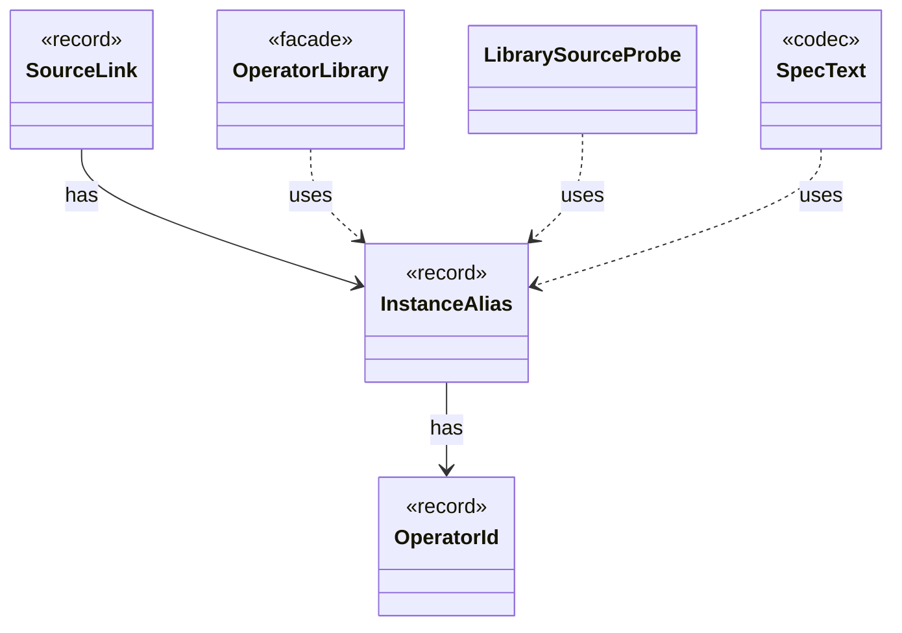

# `InstanceAlias`

`io.github.tlaplus.hardening.gen.library` · record · other · [source](https://github.com/tlaplus/model-checker-hardening/blob/fd29bdb142d5d87538f91aeddca09d5ac3d7d0a7/src/main/java/io/github/tlaplus/hardening/gen/library/InstanceAlias.java#L10) · module [gen](../modules/gen.md)

A library name the TLA+ source defines as `name(p1, ..., pn) == I!Operator(p1, ..., pn)`, where `I` is the named instance of `sourceModule`: the target's module, or the separate TLC module of a diff-linked one.

The diagram draws 5 of 6 relations; the table lists them all.

| Direction | Relation | Type | Summary |
|---|---|---|---|
| → | has | [OperatorId](io.github.tlaplus.hardening.gen.library.OperatorId.md) | Case-sensitive identity of an exported operator, independent of its generated name. |
| ← | has | [SourceLink](io.github.tlaplus.hardening.gen.library.SourceLink.md) | The module the parser and TLC evaluate, and the aliases its renderer must define through named instances. |
| ← | uses | [OperatorLibrary](io.github.tlaplus.hardening.gen.library.OperatorLibrary.md) | Immutable prepared library. |
| ← | uses | [LibrarySourceProbe](io.github.tlaplus.hardening.workflow.library.LibrarySourceProbe.md) | Parses every source alias of a prepared library once, with the classpath the parser and TLC workers receive (ADR 0015). |
| ← | uses | [SpecText](io.github.tlaplus.hardening.workflow.spec.SpecText.md) | Renders an assembled module as the TLA+ source that the parser and TLC consume. |
| → | depends | [OperatorLibrary](io.github.tlaplus.hardening.gen.library.OperatorLibrary.md) | Immutable prepared library. |
