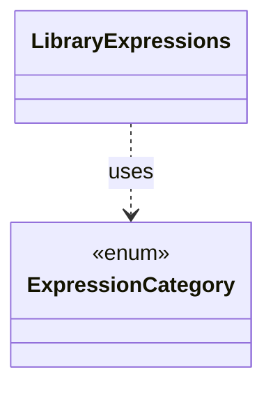

# `LibraryExpressions`

`io.github.tlaplus.hardening.gen.library` · class · other · [source](https://github.com/tlaplus/model-checker-hardening/blob/4c5cb469fa5cdcada2cd5740bce130b825b35343/src/main/java/io/github/tlaplus/hardening/gen/library/LibraryExpressions.java#L16) · module [gen](../modules/gen.md)

Lexical dependency analysis of library IR.

The diagram draws 1 of 5 relations; the table lists them all.

| Direction | Relation | Type | Summary |
|---|---|---|---|
| → | uses | [ExpressionCategory](io.github.tlaplus.hardening.gen.ExpressionCategory.md) | A user-facing category assigned to generated expression forms. |
| → | depends | [IrBinding](io.github.tlaplus.hardening.gen.ir.IrBinding.md) | Where an operator binds names: which of its arguments introduce bound names, and which arguments see them. |
| → | depends | [LibrarySyntax](io.github.tlaplus.hardening.gen.library.LibrarySyntax.md) | Supported imported IR syntax and its capabilities; `IrBinding` gives its binding layout. |
| → | depends | [LibraryTypes](io.github.tlaplus.hardening.gen.library.LibraryTypes.md) | Structural inspection of imported type terms, including row variables. |
| ← | depends | [OperatorLibrary](io.github.tlaplus.hardening.gen.library.OperatorLibrary.md) | Immutable prepared library. |
