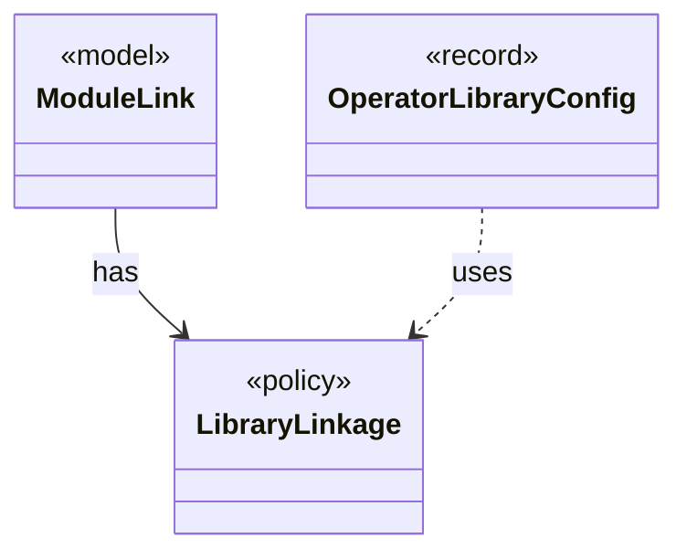

# `LibraryLinkage`

`io.github.tlaplus.hardening.gen.library` · enum · policy · key · [source](https://github.com/tlaplus/model-checker-hardening/blob/3df8c8564b58e946b95079b671788c8315f98831/src/main/java/io/github/tlaplus/hardening/gen/library/LibraryLinkage.java#L14) · module [gen](../modules/gen.md)

How a custom module's definitions reach the TLA+ source of the parser and TLC.

The diagram draws 2 of 6 relations; the table lists them all.

| Direction | Relation | Type | Summary |
|---|---|---|---|
| ← | has | [ModuleLink](io.github.tlaplus.hardening.gen.library.ModuleLink.md) | How one custom module is linked, and the module that its TLA+ source aliases instantiate: the module itself unless the linkage names a separate TLC module. |
| ← | uses | [OperatorLibraryConfig](io.github.tlaplus.hardening.config.OperatorLibraryConfig.md) | Source-only library settings. |
| ← | depends | [ConfigValueType](io.github.tlaplus.hardening.config.ConfigValueType.md) | How the value of one configuration key is read from TOML and written back as TOML syntax. |
| ← | depends | [OperatorLibrary](io.github.tlaplus.hardening.gen.library.OperatorLibrary.md) | Immutable prepared library. |
| ← | depends | [LibraryManifest](io.github.tlaplus.hardening.workflow.library.LibraryManifest.md) | Replay policy for external source snapshots. |
| ← | depends | [LibraryPreparation](io.github.tlaplus.hardening.workflow.library.LibraryPreparation.md) | Prepares custom libraries once before decoding; no importer/typechecker Maven dependency. |
