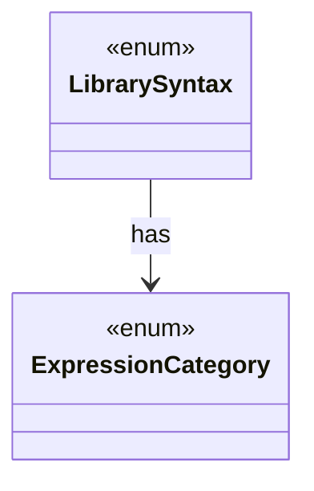

# `LibrarySyntax`

`io.github.tlaplus.hardening.gen.library` · enum · other · [source](https://github.com/tlaplus/model-checker-hardening/blob/0b7c167b636088dd43d36713d157e22f7ebd4f79/src/main/java/io/github/tlaplus/hardening/gen/library/LibrarySyntax.java#L15) · module [gen](../modules/gen.md)

Supported imported IR syntax and its capabilities; `IrBinding` gives its binding layout.

The diagram draws 1 of 2 relations; the table lists them all.

| Direction | Relation | Type | Summary |
|---|---|---|---|
| → | has | [ExpressionCategory](io.github.tlaplus.hardening.gen.ExpressionCategory.md) | A user-facing category assigned to generated expression forms. |
| ← | depends | [LibraryExpressions](io.github.tlaplus.hardening.gen.library.LibraryExpressions.md) | Lexical dependency analysis of library IR. |
