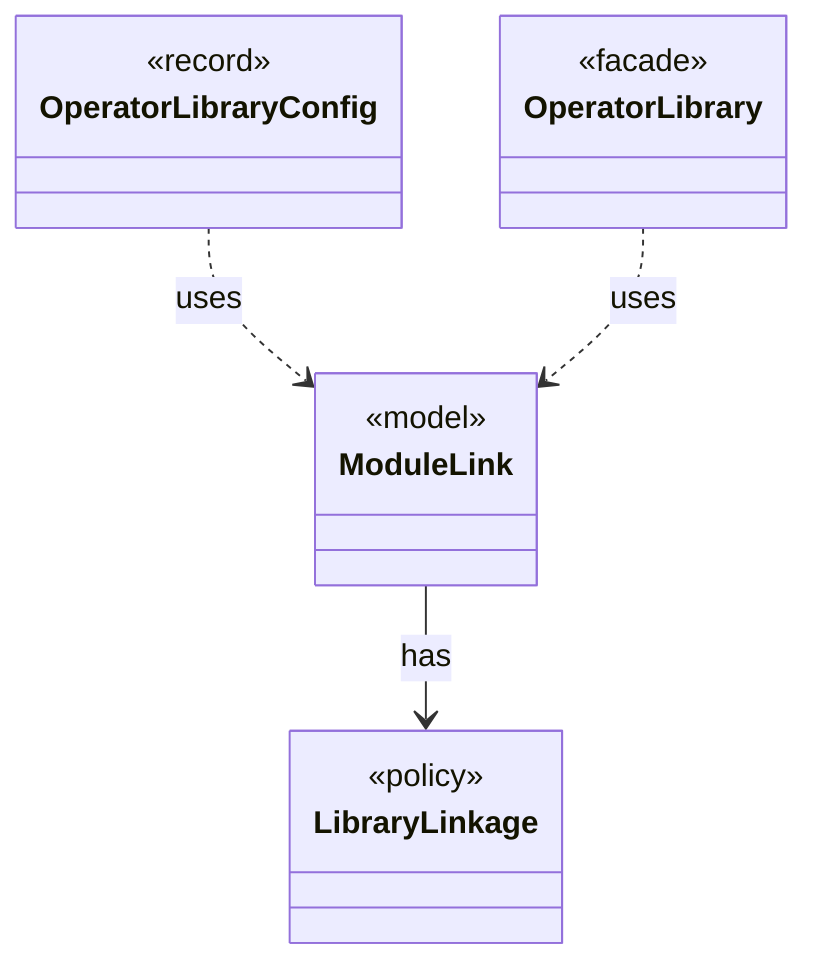

# `ModuleLink`

`io.github.tlaplus.hardening.gen.library` · record · model · key · [source](https://github.com/tlaplus/model-checker-hardening/blob/21262d9d0cc07b5ae4c47c4ee511217c9b88b561/src/main/java/io/github/tlaplus/hardening/gen/library/ModuleLink.java#L12) · module [gen](../modules/gen.md)

How one custom module is linked, and the module that its TLA+ source aliases instantiate: the module itself unless the linkage names a separate TLC module.

The diagram draws 3 of 7 relations; the table lists them all.

| Direction | Relation | Type | Summary |
|---|---|---|---|
| → | has | [LibraryLinkage](io.github.tlaplus.hardening.gen.library.LibraryLinkage.md) | How a custom module's definitions reach the TLA+ source of the parser and TLC. |
| ← | uses | [OperatorLibraryConfig](io.github.tlaplus.hardening.config.OperatorLibraryConfig.md) | Source-only library settings. |
| ← | uses | [OperatorLibrary](io.github.tlaplus.hardening.gen.library.OperatorLibrary.md) | Immutable prepared library. |
| → | depends | [OperatorId](io.github.tlaplus.hardening.gen.library.OperatorId.md) | Case-sensitive identity of an exported operator, independent of its generated name. |
| ← | depends | [ConfigValueType](io.github.tlaplus.hardening.config.ConfigValueType.md) | How the value of one configuration key is read from TOML and written back as TOML syntax. |
| ← | depends | [LibraryManifest](io.github.tlaplus.hardening.workflow.library.LibraryManifest.md) | The identity of a custom operator library's source snapshot, which a metamorphic run compares with its base corpus's (ADR 0016 §6, ADR 0025 §5). |
| ← | depends | [LibraryPreparation](io.github.tlaplus.hardening.workflow.library.LibraryPreparation.md) | Prepares custom libraries once before decoding; no importer/typechecker Maven dependency. |
