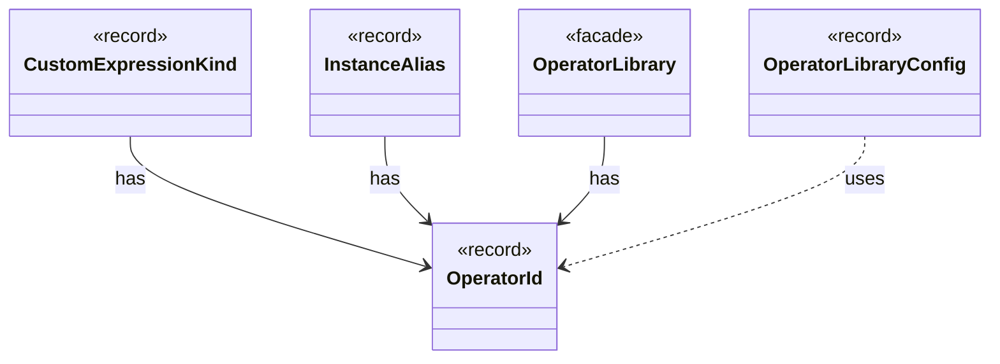

# `OperatorId`

`io.github.tlaplus.hardening.gen.library` · record · other · [source](https://github.com/tlaplus/model-checker-hardening/blob/3df8c8564b58e946b95079b671788c8315f98831/src/main/java/io/github/tlaplus/hardening/gen/library/OperatorId.java#L6) · module [gen](../modules/gen.md)

Case-sensitive identity of an exported operator, independent of its generated name.

The diagram draws 4 of 12 relations; the table lists them all.

| Direction | Relation | Type | Summary |
|---|---|---|---|
| ← | has | [CustomExpressionKind](io.github.tlaplus.hardening.gen.engine.CustomExpressionKind.md) | One configured operator kind; its type scheme comes from the immutable prepared library. |
| ← | has | [InstanceAlias](io.github.tlaplus.hardening.gen.library.InstanceAlias.md) | A library name the TLA+ source defines as `name(p1, ..., pn) == I!Operator(p1, ..., pn)`, where `I` is the named instance of `sourceModule`: the target's module, or the separate TLC module of a diff-linked one. |
| ← | has | [OperatorLibrary](io.github.tlaplus.hardening.gen.library.OperatorLibrary.md) | Immutable prepared library. |
| ← | uses | [OperatorLibraryConfig](io.github.tlaplus.hardening.config.OperatorLibraryConfig.md) | Source-only library settings. |
| ← | depends | [ConfigValueType](io.github.tlaplus.hardening.config.ConfigValueType.md) | How the value of one configuration key is read from TOML and written back as TOML syntax. |
| ← | depends | [FuzzTlaConfig](io.github.tlaplus.hardening.config.FuzzTlaConfig.md) | Complete configuration of input generation and workflow execution. |
| ← | depends | [ExpressionKindCatalog](io.github.tlaplus.hardening.gen.engine.ExpressionKindCatalog.md) | The catalog of every expression form, in decoder order. |
| ← | depends | [IrExprGenFactory](io.github.tlaplus.hardening.gen.engine.IrExprGenFactory.md) | Factory for deferred, type-directed expression generators within one generation run. |
| ← | depends | [ModuleLink](io.github.tlaplus.hardening.gen.library.ModuleLink.md) | How one custom module is linked, and the module that its TLA+ source aliases instantiate: the module itself unless the linkage names a separate TLC module. |
| ← | depends | [LibraryManifest](io.github.tlaplus.hardening.workflow.library.LibraryManifest.md) | Replay policy for external source snapshots. |
| ← | depends | [LibrarySources](io.github.tlaplus.hardening.workflow.library.LibrarySources.md) | Materializes an ordered module search path as one source-only snapshot for SANY. |
| ← | depends | [SpecText](io.github.tlaplus.hardening.workflow.spec.SpecText.md) | Renders an assembled module as the TLA+ source that the parser and TLC consume. |
