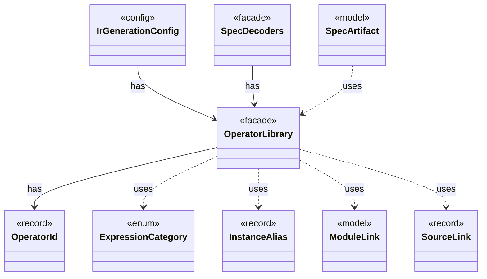

# `OperatorLibrary`

`io.github.tlaplus.hardening.gen.library` · class · facade · key · [source](https://github.com/tlaplus/model-checker-hardening/blob/4df6a11e5b4bf93609393935c4cbeceec08cce0c/src/main/java/io/github/tlaplus/hardening/gen/library/OperatorLibrary.java#L19) · module [gen](../modules/gen.md)

Immutable prepared library.

The diagram draws 8 of 20 relations; the table lists them all.

| Direction | Relation | Type | Summary |
|---|---|---|---|
| → | has | [OperatorId](io.github.tlaplus.hardening.gen.library.OperatorId.md) | Case-sensitive identity of an exported operator, independent of its generated name. |
| ← | has | [IrGenerationConfig](io.github.tlaplus.hardening.gen.IrGenerationConfig.md) | Settings for generated TLA+ expressions and modules. |
| ← | has | [SpecDecoders](io.github.tlaplus.hardening.workflow.spec.SpecDecoders.md) | Immutable registry of the decoders that turn stored payloads into checkable modules. |
| → | uses | [ExpressionCategory](io.github.tlaplus.hardening.gen.ExpressionCategory.md) | A user-facing category assigned to generated expression forms. |
| → | uses | [InstanceAlias](io.github.tlaplus.hardening.gen.library.InstanceAlias.md) | A library name the TLA+ source defines as `name(p1, ..., pn) == I!Operator(p1, ..., pn)`, where `I` is the named instance of `sourceModule`: the target's module, or the separate TLC module of a diff-linked one. |
| → | uses | [ModuleLink](io.github.tlaplus.hardening.gen.library.ModuleLink.md) | How one custom module is linked, and the module that its TLA+ source aliases instantiate: the module itself unless the linkage names a separate TLC module. |
| → | uses | [SourceLink](io.github.tlaplus.hardening.gen.library.SourceLink.md) | The module the parser and TLC evaluate, and the aliases its renderer must define through named instances. |
| ← | uses | [SpecArtifact](io.github.tlaplus.hardening.workflow.spec.SpecArtifact.md) | One assembled module, what its checkers are asked about it, and what its decoder produced. |
| → | depends | [IrNames](io.github.tlaplus.hardening.gen.ir.IrNames.md) | Names in typed IR: injective renaming and the names an expression reads from its context. |
| → | depends | [LibraryExpressions](io.github.tlaplus.hardening.gen.library.LibraryExpressions.md) | Lexical dependency analysis of library IR. |
| → | depends | [LibraryLinkage](io.github.tlaplus.hardening.gen.library.LibraryLinkage.md) | How a custom module's definitions reach the TLA+ source of the parser and TLC. |
| → | depends | [LibraryTypes](io.github.tlaplus.hardening.gen.library.LibraryTypes.md) | Structural inspection of imported type terms, including row variables. |
| ← | depends | [TomlConfig](io.github.tlaplus.hardening.config.TomlConfig.md) | Reads and writes the strict `config.toml` format used by a corpus. |
| ← | depends | [CustomExpressionKind](io.github.tlaplus.hardening.gen.engine.CustomExpressionKind.md) | One configured operator kind; its type scheme comes from the immutable prepared library. |
| ← | depends | [ExpressionKindCatalog](io.github.tlaplus.hardening.gen.engine.ExpressionKindCatalog.md) | The catalog of every expression form, in decoder order. |
| ← | depends | [IrExprGenFactory](io.github.tlaplus.hardening.gen.engine.IrExprGenFactory.md) | Factory for deferred, type-directed expression generators within one generation run. |
| ← | depends | [IrTypeGenFactory](io.github.tlaplus.hardening.gen.engine.IrTypeGenFactory.md) | Factory for deferred generators of internal types within the configured remaining-depth budget. |
| ← | depends | [InstanceAlias](io.github.tlaplus.hardening.gen.library.InstanceAlias.md) | A library name the TLA+ source defines as `name(p1, ..., pn) == I!Operator(p1, ..., pn)`, where `I` is the named instance of `sourceModule`: the target's module, or the separate TLC module of a diff-linked one. |
| ← | depends | [AdoptableBase](io.github.tlaplus.hardening.workflow.AdoptableBase.md) | The base corpus of a metamorphic run (ADR 0016 §6). |
| ← | depends | [LibraryPreparation](io.github.tlaplus.hardening.workflow.library.LibraryPreparation.md) | Prepares custom libraries once before decoding; no importer/typechecker Maven dependency. |
