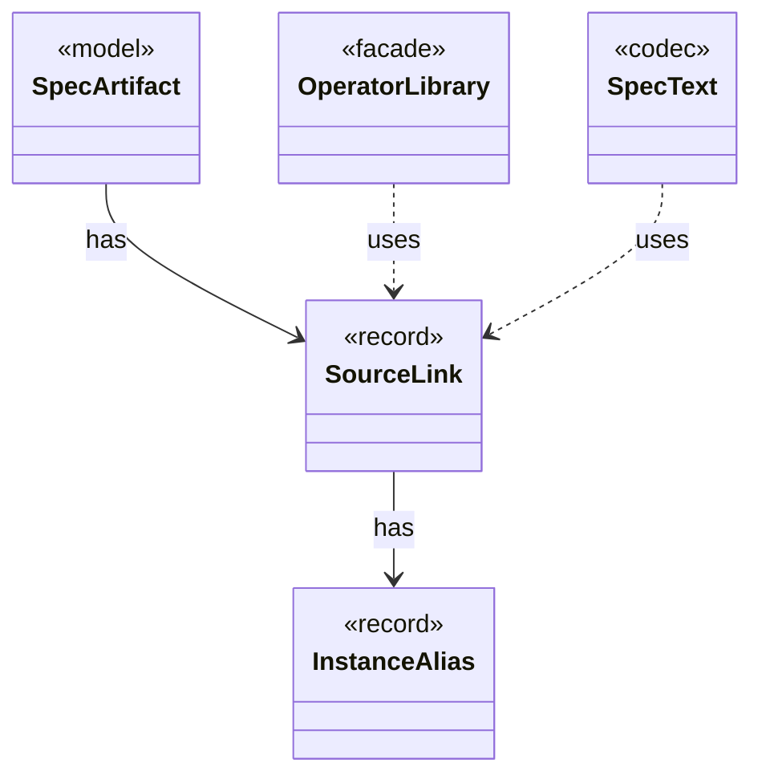

# `SourceLink`

`io.github.tlaplus.hardening.gen.library` · record · other · [source](https://github.com/tlaplus/model-checker-hardening/blob/b96eff75a5bbf8a60b15ad020d6e84735c75a47c/src/main/java/io/github/tlaplus/hardening/gen/library/SourceLink.java#L12) · module [gen](../modules/gen.md)

The module the parser and TLC evaluate, and the aliases its renderer must define through named instances.

| Direction | Relation | Type | Summary |
|---|---|---|---|
| → | has | [InstanceAlias](io.github.tlaplus.hardening.gen.library.InstanceAlias.md) | A library name the TLA+ source defines as `name(p1, ..., pn) == I!Operator(p1, ..., pn)`, where `I` is the named instance of `sourceModule`: the target's module, or the separate TLC module of a diff-linked one. |
| ← | has | [SpecArtifact](io.github.tlaplus.hardening.workflow.spec.SpecArtifact.md) | One assembled module, what its checkers are asked about it, and what its decoder produced. |
| ← | uses | [OperatorLibrary](io.github.tlaplus.hardening.gen.library.OperatorLibrary.md) | Immutable prepared library. |
| ← | uses | [SpecText](io.github.tlaplus.hardening.workflow.spec.SpecText.md) | Renders an assembled module as the TLA+ source that the parser and TLC consume. |
