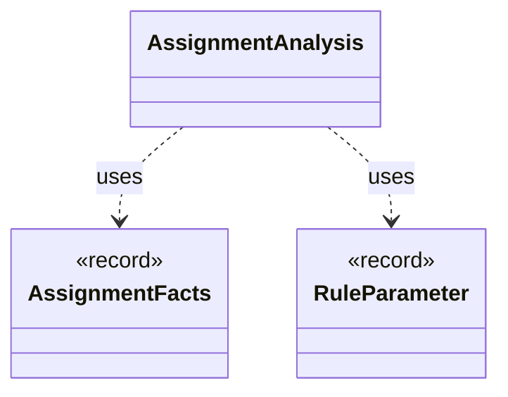

# `AssignmentAnalysis`

`io.github.tlaplus.hardening.gen.rewrite` · class · other · [source](https://github.com/tlaplus/model-checker-hardening/blob/4feb6f8e880d1e15ce9ef20c65ab53a237bd330d/src/main/java/io/github/tlaplus/hardening/gen/rewrite/AssignmentAnalysis.java#L24) · module [gen](../modules/gen.md)

Computes the `AssignmentFacts` of a rule (ADR 0017 §5.3): where its Boolean parameters stand in TLC's assignment positions, on each side and in each action (ADR 0027 §1).

**Decisions:** [ADR 0017: Rewrite rules as a TLA+ library](https://github.com/tlaplus/model-checker-hardening/blob/4feb6f8e880d1e15ce9ef20c65ab53a237bd330d/docs/decisions/0017-rewrite-rule-library.md), [ADR 0027: Metamorphic testing of temporal properties](https://github.com/tlaplus/model-checker-hardening/blob/4feb6f8e880d1e15ce9ef20c65ab53a237bd330d/docs/decisions/0027-temporal-metamorphic-testing.md)

The diagram draws 2 of 5 relations; the table lists them all.

| Direction | Relation | Type | Summary |
|---|---|---|---|
| → | uses | [AssignmentFacts](io.github.tlaplus.hardening.gen.rewrite.AssignmentFacts.md) | What a rule does to the checkers' assignments (ADR 0017 §5.3). |
| → | uses | [RuleParameter](io.github.tlaplus.hardening.gen.rewrite.RuleParameter.md) | One formal parameter of a rewrite rule, classified by where it occurs (ADR 0017 §3). |
| → | depends | [FormulaLevels](io.github.tlaplus.hardening.gen.rewrite.FormulaLevels.md) | The levels of formulas, as SANY checks them, that rules depend on (ADR 0017 §5.2, ADR 0027 §1, ir-generators.md §7.1). |
| → | depends | [RuleContract](io.github.tlaplus.hardening.gen.rewrite.RuleContract.md) | Reads one rule definition and checks the parts of the rule contract that the loader can decide (ADR 0017 §2, §3, §5, ADR 0027 §1): the shape `A = B` or `A &lt;=&gt; B`, the parameter classes, level preservation and closedness. |
| ← | depends | [RuleContract](io.github.tlaplus.hardening.gen.rewrite.RuleContract.md) | Reads one rule definition and checks the parts of the rule contract that the loader can decide (ADR 0017 §2, §3, §5, ADR 0027 §1): the shape `A = B` or `A &lt;=&gt; B`, the parameter classes, level preservation and closedness. |
