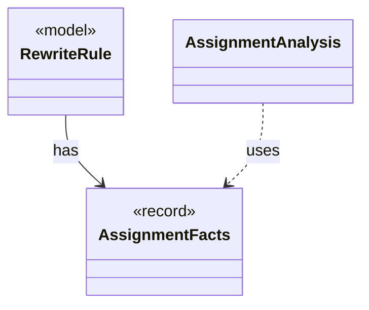

# `AssignmentFacts`

`io.github.tlaplus.hardening.gen.rewrite` · record · other · [source](https://github.com/tlaplus/model-checker-hardening/blob/7b97336d8ec341ec48f89de4a368b6a488a145ac/src/main/java/io/github/tlaplus/hardening/gen/rewrite/AssignmentFacts.java#L25) · module [gen](../modules/gen.md)

What a rule does to the checkers' assignments (ADR 0017 §5.3).

**Decisions:** [ADR 0017: Rewrite rules as a TLA+ library](https://github.com/tlaplus/model-checker-hardening/blob/7b97336d8ec341ec48f89de4a368b6a488a145ac/docs/decisions/0017-rewrite-rule-library.md)

The diagram draws 2 of 4 relations; the table lists them all.

| Direction | Relation | Type | Summary |
|---|---|---|---|
| ← | has | [RewriteRule](io.github.tlaplus.hardening.gen.rewrite.RewriteRule.md) | One rewrite rule `F(p1, ..., pn) == A = B` or `A &lt;=&gt; B` of a rule module (ADR 0017 §2): the rewriter replaces an instance of `pattern` (A) with the same instance of ` replacement` (B). |
| ← | uses | [AssignmentAnalysis](io.github.tlaplus.hardening.gen.rewrite.AssignmentAnalysis.md) | Computes the `AssignmentFacts` of a rule (ADR 0017 §5.3): where its Boolean parameters stand in TLC's assignment positions, on each side and in each action (ADR 0027 §1). |
| ← | depends | [RuleContract](io.github.tlaplus.hardening.gen.rewrite.RuleContract.md) | Reads one rule definition and checks the parts of the rule contract that the loader can decide (ADR 0017 §2, §3, §5, ADR 0027 §1): the shape `A = B` or `A &lt;=&gt; B`, the parameter classes, level preservation and closedness. |
| ← | depends | [RuleMatcher](io.github.tlaplus.hardening.gen.rewrite.RuleMatcher.md) | Matches a rule's pattern at one node (ADR 0017 §4). |
