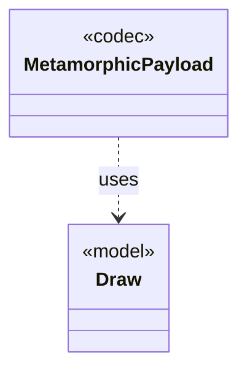

# `MetamorphicPayload`

`io.github.tlaplus.hardening.gen.rewrite` · class · codec · key · [source](https://github.com/tlaplus/model-checker-hardening/blob/4df6a11e5b4bf93609393935c4cbeceec08cce0c/src/main/java/io/github/tlaplus/hardening/gen/rewrite/MetamorphicPayload.java#L19) · module [gen](../modules/gen.md)

The layout of a metamorphic input (ADR 0016 §1):

**Decisions:** [ADR 0016: Metamorphic testing](https://github.com/tlaplus/model-checker-hardening/blob/4df6a11e5b4bf93609393935c4cbeceec08cce0c/docs/decisions/0016-metamorphic-testing.md)

The diagram draws 1 of 5 relations; the table lists them all.

| Direction | Relation | Type | Summary |
|---|---|---|---|
| → | uses | [Draw](io.github.tlaplus.hardening.gen.Draw.md) | A forward-only deterministic cursor that decodes structured choices from an unstructured byte array. |
| ← | depends | [MetamorphicShrinker](io.github.tlaplus.hardening.workflow.MetamorphicShrinker.md) | Reduces a metamorphic counterexample for triage (ADR 0016 §8). |
| ← | depends | [MetamorphicCandidates](io.github.tlaplus.hardening.workflow.input.MetamorphicCandidates.md) | Adopts elite conformance entries (ADR 0016 §6): every candidate is the payload of a uniformly drawn parent of a pbt corpus behind the metamorphic header, followed by random rewrite bytes. |
| ← | depends | [ParentPool](io.github.tlaplus.hardening.workflow.input.ParentPool.md) | The entries of `04quality-pass` that a generation mutates or adopts: those of the kind the run generates, read once when the generation starts. |
| ← | depends | [SpecDecoders](io.github.tlaplus.hardening.workflow.spec.SpecDecoders.md) | Immutable registry of the decoders that turn stored payloads into checkable modules. |
