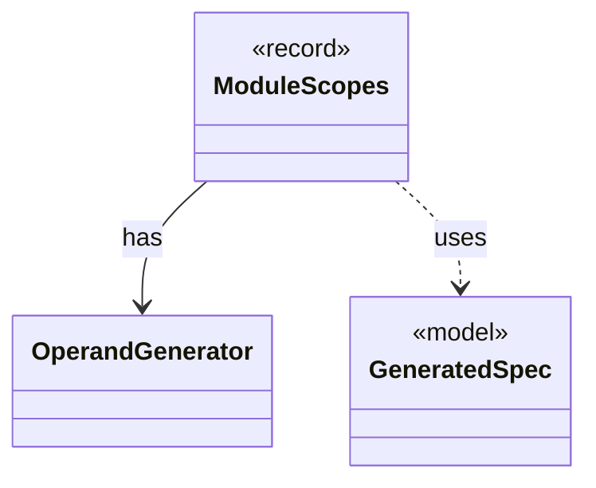

# `ModuleScopes`

`io.github.tlaplus.hardening.gen.rewrite` · record · other · [source](https://github.com/tlaplus/model-checker-hardening/blob/0434b0d13c245aeb0f8ca5e7f7b4f69467daa2da/src/main/java/io/github/tlaplus/hardening/gen/rewrite/ModuleScopes.java#L16) · module [gen](../modules/gen.md)

The names the bodies of a generated module see, as the generator drew them (ADR 0016 §2): the state variables besides `step`, `step` itself, and the auxiliary operators in declaration order.

**Decisions:** [ADR 0016: Metamorphic testing](https://github.com/tlaplus/model-checker-hardening/blob/0434b0d13c245aeb0f8ca5e7f7b4f69467daa2da/docs/decisions/0016-metamorphic-testing.md)

The diagram draws 2 of 4 relations; the table lists them all.

| Direction | Relation | Type | Summary |
|---|---|---|---|
| → | has | [OperandGenerator](io.github.tlaplus.hardening.gen.engine.OperandGenerator.md) | Draws expressions for a rewrite that leaves an operand open (ADR 0017 §3), and for the parameters of an edge guard of a graph module (ADR 0023 §6): an operand is drawn by the ordinary expression factory, at its type, in the lexical scope of the rewritten node or the edge, and in the state-level context, so an operand adds no prime. |
| → | uses | [GeneratedSpec](io.github.tlaplus.hardening.gen.GeneratedSpec.md) | The declarations one generated module consists of. |
| → | depends | [GeneratedOperator](io.github.tlaplus.hardening.gen.GeneratedOperator.md) | A generated definition, stored once in module declaration order. |
| ← | depends | [Rewriter](io.github.tlaplus.hardening.gen.rewrite.Rewriter.md) | Decodes a rewrite payload into a rewrite of a base (ADR 0016 §2). |
