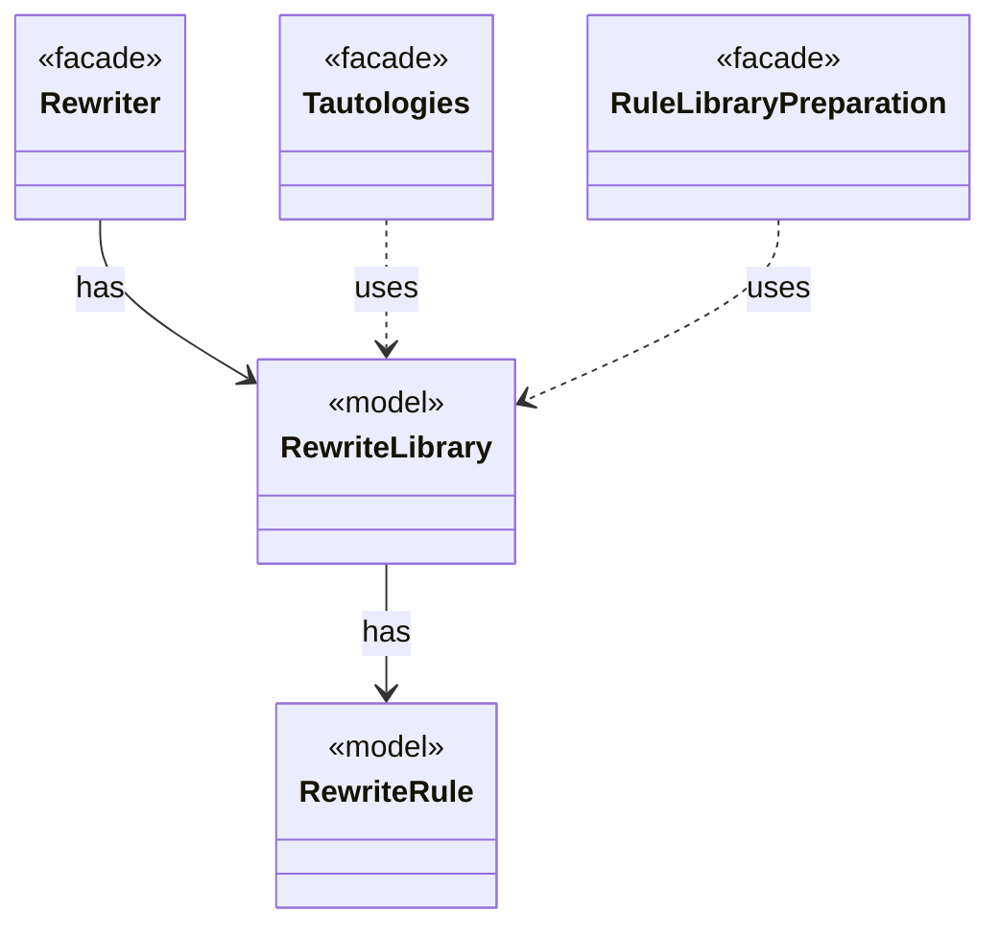

# `RewriteLibrary`

`io.github.tlaplus.hardening.gen.rewrite` · class · model · key · [source](https://github.com/tlaplus/model-checker-hardening/blob/21262d9d0cc07b5ae4c47c4ee511217c9b88b561/src/main/java/io/github/tlaplus/hardening/gen/rewrite/RewriteLibrary.java#L31) · module [gen](../modules/gen.md)

The rules of one rule module, in declaration order (ADR 0017 §1).

**Decisions:** [ADR 0017: Rewrite rules as a TLA+ library](https://github.com/tlaplus/model-checker-hardening/blob/21262d9d0cc07b5ae4c47c4ee511217c9b88b561/docs/decisions/0017-rewrite-rule-library.md)

The diagram draws 4 of 7 relations; the table lists them all.

| Direction | Relation | Type | Summary |
|---|---|---|---|
| → | has | [RewriteRule](io.github.tlaplus.hardening.gen.rewrite.RewriteRule.md) | One rewrite rule `F(p1, ..., pn) == A = B` or `A &lt;=&gt; B` of a rule module (ADR 0017 §2): the rewriter replaces an instance of `pattern` (A) with the same instance of ` replacement` (B). |
| ← | has | [Rewriter](io.github.tlaplus.hardening.gen.rewrite.Rewriter.md) | Decodes a rewrite payload into a rewrite of a base (ADR 0016 §2). |
| ← | uses | [Tautologies](io.github.tlaplus.hardening.gen.rewrite.Tautologies.md) | Draws edge guards of a graph module from a rule library (ADR 0023 §6): a guard is the formula `A = B` or `A &lt;=&gt; B` of a rule, with every parameter drawn at its type. |
| ← | uses | [RuleLibraryPreparation](io.github.tlaplus.hardening.workflow.library.RuleLibraryPreparation.md) | Loads a rule module once, before decoding (ADR 0017 §1, §6): the rewrites of a metamorphic run or the edge guards of graph inputs (ADR 0023 §6). |
| → | depends | [IrGenerationConfig](io.github.tlaplus.hardening.gen.IrGenerationConfig.md) | Settings for generated TLA+ expressions and modules. |
| → | depends | [RuleContract](io.github.tlaplus.hardening.gen.rewrite.RuleContract.md) | Reads one rule definition and checks the parts of the rule contract that the loader can decide (ADR 0017 §2, §3, §5): the shape `A = B` or `A &lt;=&gt; B`, the parameter classes, level preservation and closedness. |
| ← | depends | [SpecDecoders](io.github.tlaplus.hardening.workflow.spec.SpecDecoders.md) | Immutable registry of the decoders that turn stored payloads into checkable modules. |
