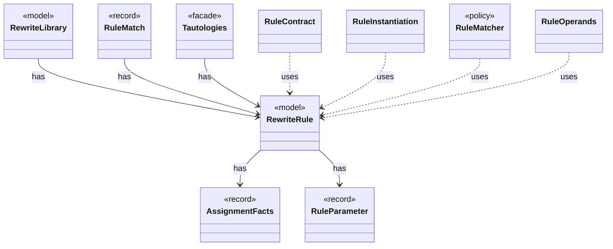

# `RewriteRule`

`io.github.tlaplus.hardening.gen.rewrite` · record · model · key · [source](https://github.com/tlaplus/model-checker-hardening/blob/21262d9d0cc07b5ae4c47c4ee511217c9b88b561/src/main/java/io/github/tlaplus/hardening/gen/rewrite/RewriteRule.java#L28) · module [gen](../modules/gen.md)

One rewrite rule `F(p1, ..., pn) == A = B` or `A &lt;=&gt; B` of a rule module (ADR 0017 §2): the rewriter replaces an instance of `pattern` (A) with the same instance of ` replacement` (B).

**Decisions:** [ADR 0017: Rewrite rules as a TLA+ library](https://github.com/tlaplus/model-checker-hardening/blob/21262d9d0cc07b5ae4c47c4ee511217c9b88b561/docs/decisions/0017-rewrite-rule-library.md), [ADR 0023: Graph-based testing](https://github.com/tlaplus/model-checker-hardening/blob/21262d9d0cc07b5ae4c47c4ee511217c9b88b561/docs/decisions/0023-graph-based-testing.md)

The diagram draws 9 of 11 relations; the table lists them all.

| Direction | Relation | Type | Summary |
|---|---|---|---|
| → | has | [AssignmentFacts](io.github.tlaplus.hardening.gen.rewrite.AssignmentFacts.md) | What a rule does to the checkers' assignments (ADR 0017 §5.3). |
| → | has | [RuleParameter](io.github.tlaplus.hardening.gen.rewrite.RuleParameter.md) | One formal parameter of a rewrite rule, classified by where it occurs (ADR 0017 §3). |
| ← | has | [RewriteLibrary](io.github.tlaplus.hardening.gen.rewrite.RewriteLibrary.md) | The rules of one rule module, in declaration order (ADR 0017 §1). |
| ← | has | [RuleMatch](io.github.tlaplus.hardening.gen.rewrite.RuleMatch.md) | A rule's pattern matched at one node. |
| ← | has | [Tautologies](io.github.tlaplus.hardening.gen.rewrite.Tautologies.md) | Draws edge guards of a graph module from a rule library (ADR 0023 §6): a guard is the formula `A = B` or `A &lt;=&gt; B` of a rule, with every parameter drawn at its type. |
| ← | uses | [RuleContract](io.github.tlaplus.hardening.gen.rewrite.RuleContract.md) | Reads one rule definition and checks the parts of the rule contract that the loader can decide (ADR 0017 §2, §3, §5): the shape `A = B` or `A &lt;=&gt; B`, the parameter classes, level preservation and closedness. |
| ← | uses | [RuleInstantiation](io.github.tlaplus.hardening.gen.rewrite.RuleInstantiation.md) | Builds the instance of a rule (ADR 0017 §4): the rule's replacement for a match, or its whole formula for an edge guard (ADR 0023 §6). |
| ← | uses | [RuleMatcher](io.github.tlaplus.hardening.gen.rewrite.RuleMatcher.md) | Matches a rule's pattern at one node (ADR 0017 §4). |
| ← | uses | [RuleOperands](io.github.tlaplus.hardening.gen.rewrite.RuleOperands.md) | Draws what instantiating a rule needs beyond a match (ADR 0017 §3): a concrete type for every type variable the match leaves open, then a value for each drawn parameter at its type. |
| → | depends | [Preconditions](io.github.tlaplus.hardening.common.Preconditions.md) | Shared validation of method and constructor arguments. |
| ← | depends | [Rewriter](io.github.tlaplus.hardening.gen.rewrite.Rewriter.md) | Decodes a rewrite payload into a rewrite of a base (ADR 0016 §2). |
