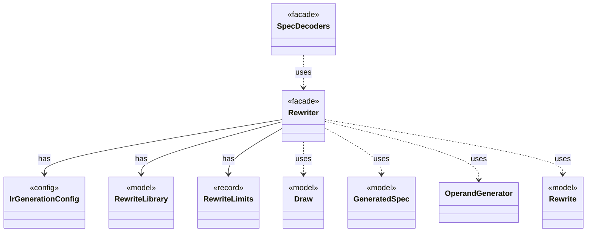

# `Rewriter`

`io.github.tlaplus.hardening.gen.rewrite` · class · facade · key · [source](https://github.com/tlaplus/model-checker-hardening/blob/ac2372d47bb5bde8dbaa1a2983a7214ae253523e/src/main/java/io/github/tlaplus/hardening/gen/rewrite/Rewriter.java#L69) · module [gen](../modules/gen.md)

Decodes a rewrite payload into a rewrite of a base (ADR 0016 §2).

**Decisions:** [ADR 0016: Metamorphic testing](https://github.com/tlaplus/model-checker-hardening/blob/ac2372d47bb5bde8dbaa1a2983a7214ae253523e/docs/decisions/0016-metamorphic-testing.md), [ADR 0027: Metamorphic testing of temporal properties](https://github.com/tlaplus/model-checker-hardening/blob/ac2372d47bb5bde8dbaa1a2983a7214ae253523e/docs/decisions/0027-temporal-metamorphic-testing.md), [ADR 0030: A budget of temporal operators per rewritten body](https://github.com/tlaplus/model-checker-hardening/blob/ac2372d47bb5bde8dbaa1a2983a7214ae253523e/docs/decisions/0030-temporal-operator-budget.md)

The diagram draws 8 of 28 relations; the table lists them all.

| Direction | Relation | Type | Summary |
|---|---|---|---|
| → | has | [IrGenerationConfig](io.github.tlaplus.hardening.gen.IrGenerationConfig.md) | Settings for generated TLA+ expressions and modules. |
| → | has | [RewriteLibrary](io.github.tlaplus.hardening.gen.rewrite.RewriteLibrary.md) | The rules of one rule module, in declaration order (ADR 0017 §1). |
| → | has | [RewriteLimits](io.github.tlaplus.hardening.gen.rewrite.RewriteLimits.md) | Bounds of one rewrite (ADR 0016 §2, §7, ADR 0030). |
| → | uses | [Draw](io.github.tlaplus.hardening.gen.Draw.md) | A forward-only deterministic cursor that decodes structured choices from an unstructured byte array. |
| → | uses | [GeneratedSpec](io.github.tlaplus.hardening.gen.GeneratedSpec.md) | The declarations one generated module consists of. |
| → | uses | [OperandGenerator](io.github.tlaplus.hardening.gen.engine.OperandGenerator.md) | Draws expressions for a rewrite that leaves an operand open (ADR 0017 §3), and for the parameters of an edge guard of a graph module (ADR 0023 §6): an operand is drawn by the ordinary expression factory, at its type, in the lexical scope of the rewritten node or the edge, and in the state-level context, so an operand adds no prime. |
| → | uses | [Rewrite](io.github.tlaplus.hardening.gen.rewrite.Rewrite.md) | A decoded metamorphic pair: the base the payload's base part decodes to, its rewrite, the orientation, and the rules applied in order. |
| ← | uses | [SpecDecoders](io.github.tlaplus.hardening.workflow.spec.SpecDecoders.md) | Immutable registry of the decoders that turn stored payloads into checkable modules. |
| → | depends | [ActionEffect](io.github.tlaplus.hardening.gen.ActionEffect.md) | Nonempty, duplicate-free effect in variable declaration order, with set-style identity. |
| → | depends | [ExpressionLimits](io.github.tlaplus.hardening.gen.ExpressionLimits.md) | Bounds on recursive construction and variable-size payloads within one expression. |
| → | depends | [GeneratedActionOperator](io.github.tlaplus.hardening.gen.GeneratedActionOperator.md) | One generated action operator: a definition the next-state action may apply. |
| → | depends | [GeneratedOperator](io.github.tlaplus.hardening.gen.GeneratedOperator.md) | A generated definition, stored once in module declaration order. |
| → | depends | [TemporalProperty](io.github.tlaplus.hardening.gen.TemporalProperty.md) | The temporal property of a generated module and the fairness that constrains it. |
| → | depends | [IrAlpha](io.github.tlaplus.hardening.gen.ir.IrAlpha.md) | Alpha-equivalence of typed IR: two expressions are equivalent when they differ only in the names of the variables and definitions they bind. |
| → | depends | [IrBinding](io.github.tlaplus.hardening.gen.ir.IrBinding.md) | Where an operator binds names: which of its arguments introduce bound names, and which arguments see them. |
| → | depends | [IrNames](io.github.tlaplus.hardening.gen.ir.IrNames.md) | Names in typed IR: injective renaming and the names an expression reads from its context. |
| → | depends | [FormulaLevels](io.github.tlaplus.hardening.gen.rewrite.FormulaLevels.md) | The levels of formulas, as SANY checks them, that rules depend on (ADR 0017 §5.2, ADR 0027 §1, ir-generators.md §7.1). |
| → | depends | [ModuleScopes](io.github.tlaplus.hardening.gen.rewrite.ModuleScopes.md) | The names the bodies of a generated module see, as the generator drew them (ADR 0016 §2): the state variables besides `step`, `step` itself, and the auxiliary operators in declaration order. |
| → | depends | [Orientation](io.github.tlaplus.hardening.gen.rewrite.Orientation.md) | Which side of a metamorphic pair the checker explores (ADR 0016 §3). |
| → | depends | [RewritePositions](io.github.tlaplus.hardening.gen.rewrite.RewritePositions.md) | Where the rewriter may apply a rule. |
| → | depends | [RewriteRule](io.github.tlaplus.hardening.gen.rewrite.RewriteRule.md) | One rewrite rule `F(p1, ..., pn) == A = B` or `A &lt;=&gt; B` of a rule module (ADR 0017 §2): the rewriter replaces an instance of `pattern` (A) with the same instance of ` replacement` (B). |
| → | depends | [RuleInstantiation](io.github.tlaplus.hardening.gen.rewrite.RuleInstantiation.md) | Builds the instance of a rule (ADR 0017 §4): the rule's replacement for a match, or its whole formula for an edge guard (ADR 0023 §6). |
| → | depends | [RuleLevels](io.github.tlaplus.hardening.gen.rewrite.RuleLevels.md) | What the levels of a rule require of a match (ADR 0027 §1). |
| → | depends | [RuleMatch](io.github.tlaplus.hardening.gen.rewrite.RuleMatch.md) | A rule's pattern matched at one node. |
| → | depends | [RuleMatcher](io.github.tlaplus.hardening.gen.rewrite.RuleMatcher.md) | Matches a rule's pattern at one node (ADR 0017 §4). |
| → | depends | [RuleOperands](io.github.tlaplus.hardening.gen.rewrite.RuleOperands.md) | Draws what instantiating a rule needs beyond a match (ADR 0017 §3): a concrete type for every type variable the match leaves open, then a value for each drawn parameter at its type. |
| → | depends | [RuleParameter](io.github.tlaplus.hardening.gen.rewrite.RuleParameter.md) | One formal parameter of a rewrite rule, classified by where it occurs (ADR 0017 §3). |
| ← | depends | [Tautologies](io.github.tlaplus.hardening.gen.rewrite.Tautologies.md) | Draws edge guards of a graph module from a rule library (ADR 0023 §6): a guard is the formula `A = B` or `A &lt;=&gt; B` of a rule, with every parameter drawn at its type. |
