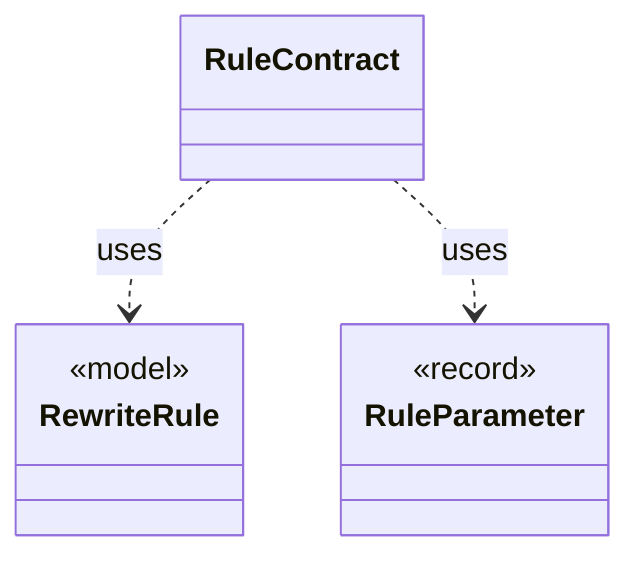

# `RuleContract`

`io.github.tlaplus.hardening.gen.rewrite` · class · other · [source](https://github.com/tlaplus/model-checker-hardening/blob/4c5cb469fa5cdcada2cd5740bce130b825b35343/src/main/java/io/github/tlaplus/hardening/gen/rewrite/RuleContract.java#L34) · module [gen](../modules/gen.md)

Reads one rule definition and checks the parts of the rule contract that the loader can decide (ADR 0017 §2, §3, §5): the shape `A = B` or `A &lt;=&gt; B`, the parameter classes, level preservation and closedness.

**Decisions:** [ADR 0017: Rewrite rules as a TLA+ library](https://github.com/tlaplus/model-checker-hardening/blob/4c5cb469fa5cdcada2cd5740bce130b825b35343/docs/decisions/0017-rewrite-rule-library.md)

The diagram draws 2 of 11 relations; the table lists them all.

| Direction | Relation | Type | Summary |
|---|---|---|---|
| → | uses | [RewriteRule](io.github.tlaplus.hardening.gen.rewrite.RewriteRule.md) | One rewrite rule `F(p1, ..., pn) == A = B` or `A &lt;=&gt; B` of a rule module (ADR 0017 §2): the rewriter replaces an instance of `pattern` (A) with the same instance of ` replacement` (B). |
| → | uses | [RuleParameter](io.github.tlaplus.hardening.gen.rewrite.RuleParameter.md) | One formal parameter of a rewrite rule, classified by where it occurs (ADR 0017 §3). |
| → | depends | [IrBinding](io.github.tlaplus.hardening.gen.ir.IrBinding.md) | Where an operator binds names: which of its arguments introduce bound names, and which arguments see them. |
| → | depends | [IrNames](io.github.tlaplus.hardening.gen.ir.IrNames.md) | Names in typed IR: injective renaming and the names an expression reads from its context. |
| → | depends | [AssignmentFacts](io.github.tlaplus.hardening.gen.rewrite.AssignmentFacts.md) | What a rule does to the checkers' assignments (ADR 0017 §5.3). |
| → | depends | [LabelPlacement](io.github.tlaplus.hardening.gen.rewrite.LabelPlacement.md) | Where a rule's replacement may not carry a label of the node it rewrites. |
| → | depends | [LetSpecialization](io.github.tlaplus.hardening.gen.rewrite.LetSpecialization.md) | Specializes every LET definition of a rule's replacement to the types at which the replacement applies it. |
| ← | depends | [LetSpecialization](io.github.tlaplus.hardening.gen.rewrite.LetSpecialization.md) | Specializes every LET definition of a rule's replacement to the types at which the replacement applies it. |
| ← | depends | [RewriteLibrary](io.github.tlaplus.hardening.gen.rewrite.RewriteLibrary.md) | The rules of one rule module, in declaration order (ADR 0017 §1). |
| ← | depends | [RuleMatcher](io.github.tlaplus.hardening.gen.rewrite.RuleMatcher.md) | Matches a rule's pattern at one node (ADR 0017 §4). |
| ← | depends | [Tautologies](io.github.tlaplus.hardening.gen.rewrite.Tautologies.md) | Draws edge guards of a graph module from a rule library (ADR 0023 §6): a guard is the formula `A = B` or `A &lt;=&gt; B` of a rule, with every parameter drawn at its type. |
