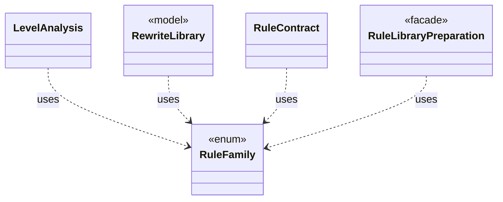

# `RuleFamily`

`io.github.tlaplus.hardening.gen.rewrite` · enum · other · [source](https://github.com/tlaplus/model-checker-hardening/blob/efb80f561357d9a62d3b24e493bb2f450ab6410c/src/main/java/io/github/tlaplus/hardening/gen/rewrite/RuleFamily.java#L4) · module [gen](../modules/gen.md)

Which rules a rule module may hold, and where they apply (ADR 0017, ADR 0027 §1).

**Decisions:** [ADR 0017: Rewrite rules as a TLA+ library](https://github.com/tlaplus/model-checker-hardening/blob/efb80f561357d9a62d3b24e493bb2f450ab6410c/docs/decisions/0017-rewrite-rule-library.md), [ADR 0027: Metamorphic testing of temporal properties](https://github.com/tlaplus/model-checker-hardening/blob/efb80f561357d9a62d3b24e493bb2f450ab6410c/docs/decisions/0027-temporal-metamorphic-testing.md)

The diagram draws 4 of 5 relations; the table lists them all.

| Direction | Relation | Type | Summary |
|---|---|---|---|
| ← | uses | [LevelAnalysis](io.github.tlaplus.hardening.gen.rewrite.LevelAnalysis.md) | Computes the `RuleLevels` of a rule as its loader checks it (ADR 0027 §1). |
| ← | uses | [RewriteLibrary](io.github.tlaplus.hardening.gen.rewrite.RewriteLibrary.md) | The rules of one rule module, in declaration order (ADR 0017 §1). |
| ← | uses | [RuleContract](io.github.tlaplus.hardening.gen.rewrite.RuleContract.md) | Reads one rule definition and checks the parts of the rule contract that the loader can decide (ADR 0017 §2, §3, §5, ADR 0027 §1): the shape `A = B` or `A &lt;=&gt; B`, the parameter classes, level preservation and closedness. |
| ← | uses | [RuleLibraryPreparation](io.github.tlaplus.hardening.workflow.library.RuleLibraryPreparation.md) | Loads a rule module once, before decoding (ADR 0017 §1, §6): the rewrites of a metamorphic run, its temporal rewrites (ADR 0027 §1), or the edge guards of graph inputs (ADR 0023 §6). |
| ← | depends | [SpecDecoders](io.github.tlaplus.hardening.workflow.spec.SpecDecoders.md) | Immutable registry of the decoders that turn stored payloads into checkable modules. |
