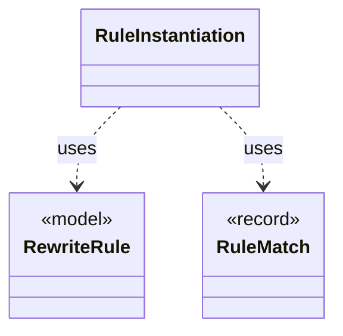

# `RuleInstantiation`

`io.github.tlaplus.hardening.gen.rewrite` · class · other · [source](https://github.com/tlaplus/model-checker-hardening/blob/e180a3892e661e5d7ba7636c4f24a6fca66ded14/src/main/java/io/github/tlaplus/hardening/gen/rewrite/RuleInstantiation.java#L19) · module [gen](../modules/gen.md)

Builds the instance of a rule (ADR 0017 §4): the rule's replacement for a match, or its whole formula for an edge guard (ADR 0023 §6).

**Decisions:** [ADR 0017: Rewrite rules as a TLA+ library](https://github.com/tlaplus/model-checker-hardening/blob/e180a3892e661e5d7ba7636c4f24a6fca66ded14/docs/decisions/0017-rewrite-rule-library.md), [ADR 0023: Graph-based testing](https://github.com/tlaplus/model-checker-hardening/blob/e180a3892e661e5d7ba7636c4f24a6fca66ded14/docs/decisions/0023-graph-based-testing.md)

The diagram draws 2 of 8 relations; the table lists them all.

| Direction | Relation | Type | Summary |
|---|---|---|---|
| → | uses | [RewriteRule](io.github.tlaplus.hardening.gen.rewrite.RewriteRule.md) | One rewrite rule `F(p1, ..., pn) == A = B` or `A &lt;=&gt; B` of a rule module (ADR 0017 §2): the rewriter replaces an instance of `pattern` (A) with the same instance of ` replacement` (B). |
| → | uses | [RuleMatch](io.github.tlaplus.hardening.gen.rewrite.RuleMatch.md) | A rule's pattern matched at one node. |
| → | depends | [IrNames](io.github.tlaplus.hardening.gen.ir.IrNames.md) | Names in typed IR: injective renaming and the names an expression reads from its context. |
| → | depends | [IrSubstitution](io.github.tlaplus.hardening.gen.ir.IrSubstitution.md) | Substitution and beta-reduction of typed IR. |
| → | depends | [IrTypes](io.github.tlaplus.hardening.gen.ir.IrTypes.md) | Type tags of typed IR. |
| → | depends | [RuleParameter](io.github.tlaplus.hardening.gen.rewrite.RuleParameter.md) | One formal parameter of a rewrite rule, classified by where it occurs (ADR 0017 §3). |
| ← | depends | [Rewriter](io.github.tlaplus.hardening.gen.rewrite.Rewriter.md) | Decodes a rewrite payload into a rewrite of a base (ADR 0016 §2). |
| ← | depends | [Tautologies](io.github.tlaplus.hardening.gen.rewrite.Tautologies.md) | Draws edge guards of a graph module from a rule library (ADR 0023 §6): a guard is the formula `A = B` or `A &lt;=&gt; B` of a rule, with every parameter drawn at its type. |
