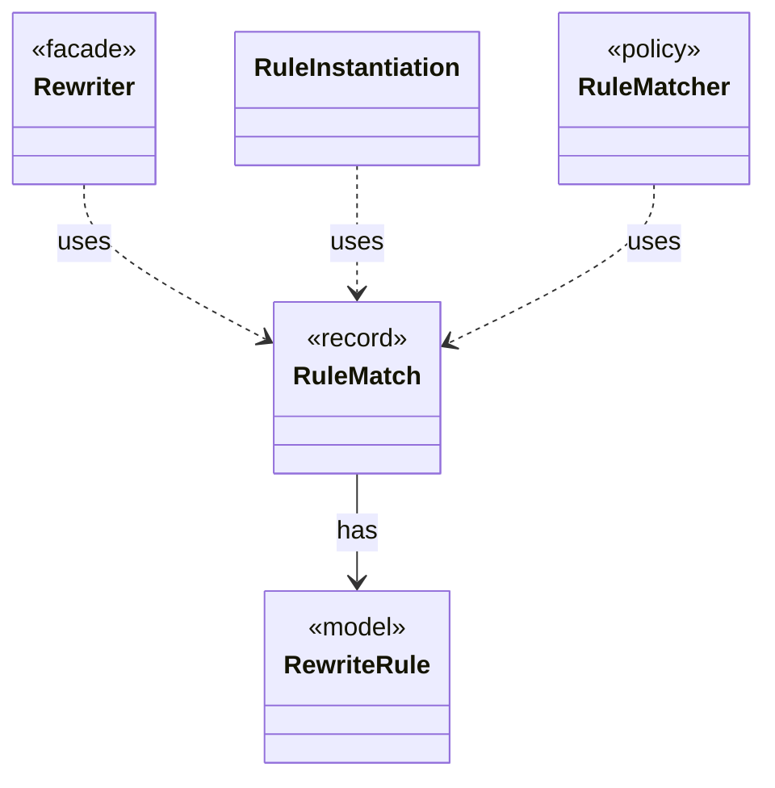

# `RuleMatch`

`io.github.tlaplus.hardening.gen.rewrite` · record · other · [source](https://github.com/tlaplus/model-checker-hardening/blob/3df8c8564b58e946b95079b671788c8315f98831/src/main/java/io/github/tlaplus/hardening/gen/rewrite/RuleMatch.java#L14) · module [gen](../modules/gen.md)

A rule's pattern matched at one node.

| Direction | Relation | Type | Summary |
|---|---|---|---|
| → | has | [RewriteRule](io.github.tlaplus.hardening.gen.rewrite.RewriteRule.md) | One rewrite rule `F(p1, ..., pn) == A = B` of a rule module (ADR 0017 §2): the rewriter replaces an instance of `pattern` (A) with the same instance of `replacement` (B). |
| ← | uses | [Rewriter](io.github.tlaplus.hardening.gen.rewrite.Rewriter.md) | Decodes a rewrite payload into a rewrite of a base (ADR 0016 §2). |
| ← | uses | [RuleInstantiation](io.github.tlaplus.hardening.gen.rewrite.RuleInstantiation.md) | Builds the replacement of a match (ADR 0017 §4): the rule's replacement with its own binders renamed apart, its types instantiated, its parameters substituted and its lambdas applied. |
| ← | uses | [RuleMatcher](io.github.tlaplus.hardening.gen.rewrite.RuleMatcher.md) | Matches a rule's pattern at one node (ADR 0017 §4). |
