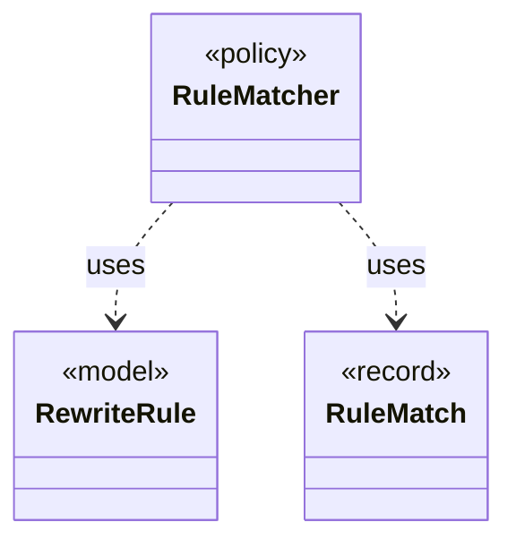

# `RuleMatcher`

`io.github.tlaplus.hardening.gen.rewrite` · class · policy · key · [source](https://github.com/tlaplus/model-checker-hardening/blob/12d0a3fd62c72add470e6ee06490c4e3591f490e/src/main/java/io/github/tlaplus/hardening/gen/rewrite/RuleMatcher.java#L53) · module [gen](../modules/gen.md)

Matches a rule's pattern at one node (ADR 0017 §4).

**Decisions:** [ADR 0017: Rewrite rules as a TLA+ library](https://github.com/tlaplus/model-checker-hardening/blob/12d0a3fd62c72add470e6ee06490c4e3591f490e/docs/decisions/0017-rewrite-rule-library.md)

The diagram draws 2 of 9 relations; the table lists them all.

| Direction | Relation | Type | Summary |
|---|---|---|---|
| → | uses | [RewriteRule](io.github.tlaplus.hardening.gen.rewrite.RewriteRule.md) | One rewrite rule `F(p1, ..., pn) == A = B` or `A &lt;=&gt; B` of a rule module (ADR 0017 §2): the rewriter replaces an instance of `pattern` (A) with the same instance of ` replacement` (B). |
| → | uses | [RuleMatch](io.github.tlaplus.hardening.gen.rewrite.RuleMatch.md) | A rule's pattern matched at one node. |
| → | depends | [IrAlpha](io.github.tlaplus.hardening.gen.ir.IrAlpha.md) | Alpha-equivalence of typed IR: two expressions are equivalent when they differ only in the names of the variables and definitions they bind. |
| → | depends | [IrBinding](io.github.tlaplus.hardening.gen.ir.IrBinding.md) | Where an operator binds names: which of its arguments introduce bound names, and which arguments see them. |
| → | depends | [IrNames](io.github.tlaplus.hardening.gen.ir.IrNames.md) | Names in typed IR: injective renaming and the names an expression reads from its context. |
| → | depends | [AssignmentFacts](io.github.tlaplus.hardening.gen.rewrite.AssignmentFacts.md) | What a rule does to TLC's assignments (ADR 0017 §5.3). |
| → | depends | [RuleContract](io.github.tlaplus.hardening.gen.rewrite.RuleContract.md) | Reads one rule definition and checks the parts of the rule contract that the loader can decide (ADR 0017 §2, §3, §5): the shape `A = B` or `A &lt;=&gt; B`, the parameter classes, level preservation and closedness. |
| → | depends | [RuleParameter](io.github.tlaplus.hardening.gen.rewrite.RuleParameter.md) | One formal parameter of a rewrite rule, classified by where it occurs (ADR 0017 §3). |
| ← | depends | [Rewriter](io.github.tlaplus.hardening.gen.rewrite.Rewriter.md) | Decodes a rewrite payload into a rewrite of a base (ADR 0016 §2). |
