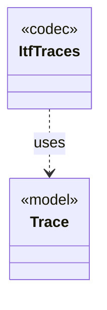

# `ItfTraces`

`io.github.tlaplus.hardening.gen.trace` · class · codec · key · [source](https://github.com/tlaplus/model-checker-hardening/blob/b1d642d707df18a7597ce87d7e826c837e78f842/src/main/java/io/github/tlaplus/hardening/gen/trace/ItfTraces.java#L45) · module [gen](../modules/gen.md)

Reads a counterexample that a checker worker recorded (ADR 0034 §5) into a canonical `Trace`.

**Decisions:** [ADR 0034: Replaying counterexamples as corpus inputs](https://github.com/tlaplus/model-checker-hardening/blob/b1d642d707df18a7597ce87d7e826c837e78f842/docs/decisions/0034-counterexample-replay.md)

The diagram draws 1 of 4 relations; the table lists them all.

| Direction | Relation | Type | Summary |
|---|---|---|---|
| → | uses | [Trace](io.github.tlaplus.hardening.gen.trace.Trace.md) | The states of one recorded counterexample and what its last state claims (ADR 0034 §1, §2). |
| → | depends | [TraceEnding](io.github.tlaplus.hardening.gen.trace.TraceEnding.md) | What the last state of a recorded trace claims (ADR 0034 §1), which decides what its replay checks there. |
| → | depends | [TracePayload](io.github.tlaplus.hardening.gen.trace.TracePayload.md) | The payload of a `trace` input (ADR 0034 §2), a CBOR array in deterministic encoding: |
| ← | depends | [RecordedTraces](io.github.tlaplus.hardening.workflow.tool.RecordedTraces.md) | Turns the trace a checker worker recorded into what its stage stores (ADR 0034 §5): read at the types of the module's variables, then encoded canonically. |
