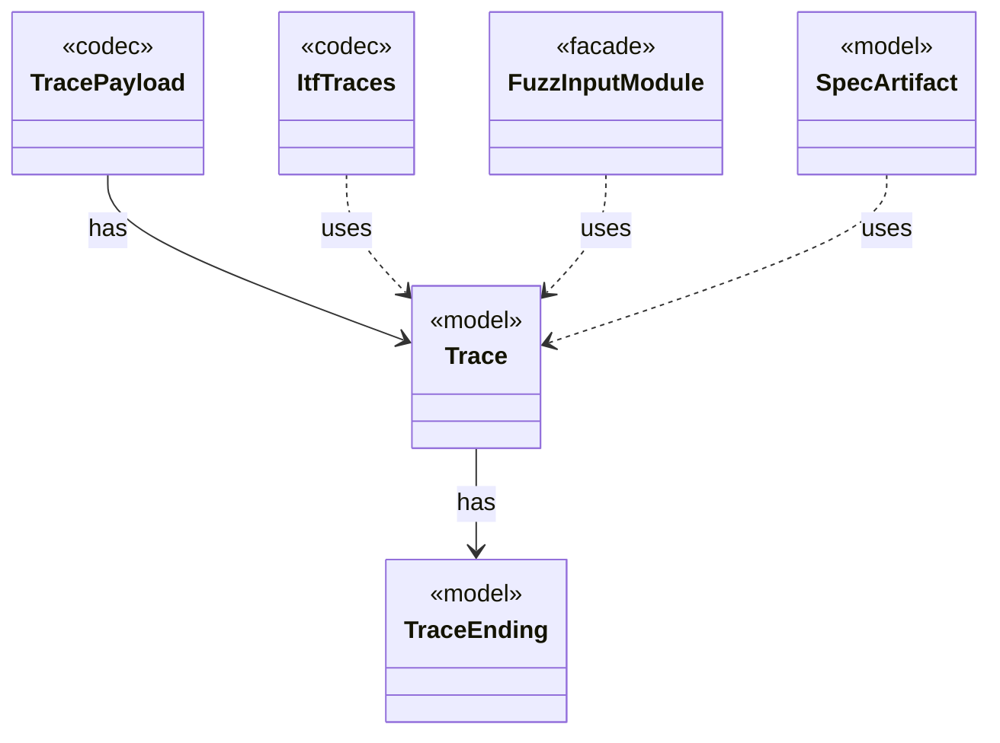

# `Trace`

`io.github.tlaplus.hardening.gen.trace` · record · model · key · [source](https://github.com/tlaplus/model-checker-hardening/blob/33d03ca7780f0879c0203f4b1eede232bb04eb8e/src/main/java/io/github/tlaplus/hardening/gen/trace/Trace.java#L22) · module [gen](../modules/gen.md)

The states of one recorded counterexample and what its last state claims (ADR 0034 §1, §2).

**Decisions:** [ADR 0034: Replaying counterexamples as corpus inputs](https://github.com/tlaplus/model-checker-hardening/blob/33d03ca7780f0879c0203f4b1eede232bb04eb8e/docs/decisions/0034-counterexample-replay.md)

The diagram draws 5 of 11 relations; the table lists them all.

| Direction | Relation | Type | Summary |
|---|---|---|---|
| → | has | [TraceEnding](io.github.tlaplus.hardening.gen.trace.TraceEnding.md) | What the last state of a recorded trace claims (ADR 0034 §1), which decides what its replay checks there. |
| ← | has | [TracePayload](io.github.tlaplus.hardening.gen.trace.TracePayload.md) | The payload of a `trace` input (ADR 0034 §2), a CBOR array in deterministic encoding: |
| ← | uses | [ItfTraces](io.github.tlaplus.hardening.gen.trace.ItfTraces.md) | Reads a counterexample that a checker worker recorded (ADR 0034 §5) into a canonical `Trace`. |
| ← | uses | [FuzzInputModule](io.github.tlaplus.hardening.workflow.spec.FuzzInputModule.md) | Assembles the module checked by the parser and model-checker stages. |
| ← | uses | [SpecArtifact](io.github.tlaplus.hardening.workflow.spec.SpecArtifact.md) | One assembled module, what its checkers are asked about it, and what its decoder produced. |
| → | depends | [Preconditions](io.github.tlaplus.hardening.common.Preconditions.md) | Shared validation of method and constructor arguments. |
| ← | depends | [DecodedInputRenderer](io.github.tlaplus.hardening.cli.DecodedInputRenderer.md) | Renders a decoded input independently of picocli command wiring. |
| ← | depends | [ReplayCandidates](io.github.tlaplus.hardening.workflow.input.ReplayCandidates.md) | Replays one recorded counterexample (ADR 0034 §6): the single candidate of its target is the `trace` payload of a parent's trace. |
| ← | depends | [PredictedOutcomes](io.github.tlaplus.hardening.workflow.spec.PredictedOutcomes.md) | Predicts the outcome of an entry whose kind predicts one: a graph entry, by replaying it through the decoders (ADR 0023 §4): a counterexample of the target's distance when a behaviour reaches the target within the step bound, and a pass otherwise; a trace entry (ADR 0034 §4): a counterexample of exactly the trace's transitions, which its payload states without decoding the base. |
| ← | depends | [SpecDecoders](io.github.tlaplus.hardening.workflow.spec.SpecDecoders.md) | Immutable registry of the decoders that turn stored payloads into checkable modules. |
| ← | depends | [RecordedTraces](io.github.tlaplus.hardening.workflow.tool.RecordedTraces.md) | Turns the trace a checker worker recorded into what its stage stores (ADR 0034 §5): read at the types of the module's variables, then encoded canonically. |
