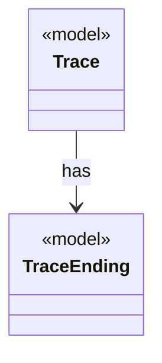

# `TraceEnding`

`io.github.tlaplus.hardening.gen.trace` · interface · model · key · [source](https://github.com/tlaplus/model-checker-hardening/blob/ec784e8112438ead18c35b5a2e7e27b2d25a076b/src/main/java/io/github/tlaplus/hardening/gen/trace/TraceEnding.java#L12) · module [gen](../modules/gen.md)

What the last state of a recorded trace claims (ADR 0034 §1), which decides what its replay checks there.

**Decisions:** [ADR 0034: Replaying counterexamples as corpus inputs](https://github.com/tlaplus/model-checker-hardening/blob/ec784e8112438ead18c35b5a2e7e27b2d25a076b/docs/decisions/0034-counterexample-replay.md)

The diagram draws 1 of 5 relations; the table lists them all.

| Direction | Relation | Type | Summary |
|---|---|---|---|
| ← | has | [Trace](io.github.tlaplus.hardening.gen.trace.Trace.md) | The states of one recorded counterexample and what its last state claims (ADR 0034 §1, §2). |
| → | depends | [Preconditions](io.github.tlaplus.hardening.common.Preconditions.md) | Shared validation of method and constructor arguments. |
| ← | depends | [DecodedInputRenderer](io.github.tlaplus.hardening.cli.DecodedInputRenderer.md) | Renders a decoded input independently of picocli command wiring. |
| ← | depends | [TracePayload](io.github.tlaplus.hardening.gen.trace.TracePayload.md) | The payload of a `trace` input (ADR 0034 §2), a CBOR array in deterministic encoding: |
| ← | depends | [FuzzInputModule](io.github.tlaplus.hardening.workflow.spec.FuzzInputModule.md) | Assembles the module checked by the parser and model-checker stages. |
