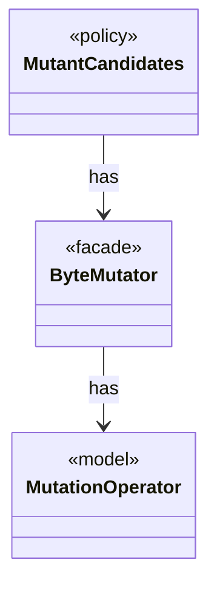

# `ByteMutator`

`io.github.tlaplus.hardening.mutation` · class · facade · key · [source](https://github.com/tlaplus/model-checker-hardening/blob/12d0a3fd62c72add470e6ee06490c4e3591f490e/src/main/java/io/github/tlaplus/hardening/mutation/ByteMutator.java#L24) · module [mutation](../modules/mutation.md)

Derives one mutant from a parent by stacking weighted operator edits.

The diagram draws 2 of 4 relations; the table lists them all.

| Direction | Relation | Type | Summary |
|---|---|---|---|
| → | has | [MutationOperator](io.github.tlaplus.hardening.mutation.MutationOperator.md) | One byte-level edit of a generator input, as ADR 0010 defines it. |
| ← | has | [MutantCandidates](io.github.tlaplus.hardening.workflow.input.MutantCandidates.md) | Mutants of the parent pool (ADR 0010): every candidate mutates a uniformly drawn parent, keeps its cohort, and is rejected as a clone when it renders to the parent's module. |
| → | depends | [Preconditions](io.github.tlaplus.hardening.common.Preconditions.md) | Shared validation of method and constructor arguments. |
| ← | depends | [GenerationLoop](io.github.tlaplus.hardening.workflow.GenerationLoop.md) | Runs the generations of one workflow invocation over a single stage graph (ADR 0010). |
