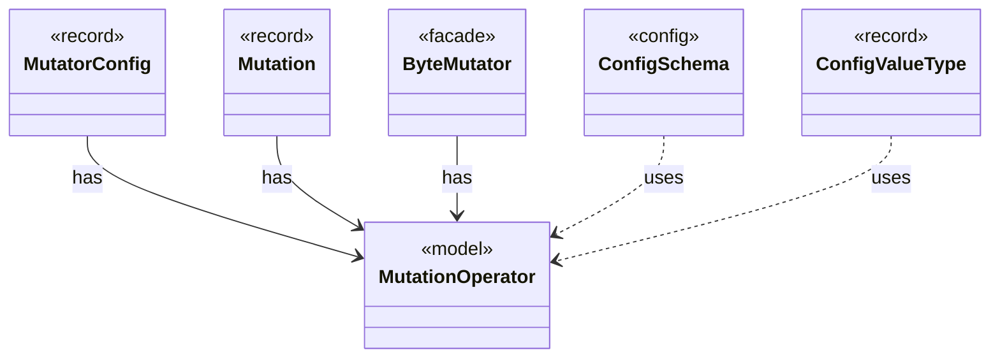

# `MutationOperator`

`io.github.tlaplus.hardening.mutation` · enum · model · key · [source](https://github.com/tlaplus/model-checker-hardening/blob/12d0a3fd62c72add470e6ee06490c4e3591f490e/src/main/java/io/github/tlaplus/hardening/mutation/MutationOperator.java#L24) · module [mutation](../modules/mutation.md)

One byte-level edit of a generator input, as ADR 0010 defines it.

**Decisions:** [ADR 0010: Generational mutation](https://github.com/tlaplus/model-checker-hardening/blob/12d0a3fd62c72add470e6ee06490c4e3591f490e/docs/decisions/0010-mutation.md), [ADR 0016: Metamorphic testing](https://github.com/tlaplus/model-checker-hardening/blob/12d0a3fd62c72add470e6ee06490c4e3591f490e/docs/decisions/0016-metamorphic-testing.md)

The diagram draws 5 of 10 relations; the table lists them all.

| Direction | Relation | Type | Summary |
|---|---|---|---|
| ← | has | [MutatorConfig](io.github.tlaplus.hardening.config.MutatorConfig.md) | Generations, the quality gate's selection, and the mutator's share and operators (ADR 0010). |
| ← | has | [Mutation](io.github.tlaplus.hardening.corpus.Mutation.md) | How a mutated input was derived: the digest of the parent it was mutated from and the operators applied to the parent, in order. |
| ← | has | [ByteMutator](io.github.tlaplus.hardening.mutation.ByteMutator.md) | Derives one mutant from a parent by stacking weighted operator edits. |
| ← | uses | [ConfigSchema](io.github.tlaplus.hardening.config.ConfigSchema.md) | The declaration of every key in `config.toml`: where it lives, what it means, how its value is read, and how it is written back. |
| ← | uses | [ConfigValueType](io.github.tlaplus.hardening.config.ConfigValueType.md) | How the value of one configuration key is read from TOML and written back as TOML syntax. |
| ← | depends | [EnvelopeReport](io.github.tlaplus.hardening.cli.EnvelopeReport.md) | Renders a decoded corpus envelope and its expression as plain text. |
| ← | depends | [CorpusInputCodec](io.github.tlaplus.hardening.corpus.CorpusInputCodec.md) | Encodes and decodes an input's kind, generator payload, and admission metadata. |
| ← | depends | [EntryOrigin](io.github.tlaplus.hardening.corpus.EntryOrigin.md) | Which candidate source admitted an entry, as its generation metadata records it (ADR 0010, ADR 0016 §6). |
| ← | depends | [EntryRows](io.github.tlaplus.hardening.database.EntryRows.md) | The rows that one decoded corpus entry contributes: its `entry` row, followed by the rows that reference it: one `knownDefect` row per signature, one `mutationOperator` row per operator, one `stage` row per stage record, one `expr` row per expression construct of its replayed input and one `exprEdge` row per edge between constructs. |
| ← | depends | [MetamorphicCandidates](io.github.tlaplus.hardening.workflow.input.MetamorphicCandidates.md) | Adopts elite conformance entries (ADR 0016 §6): every candidate is the payload of a uniformly drawn parent of a pbt corpus behind the metamorphic header, followed by random rewrite bytes. |
