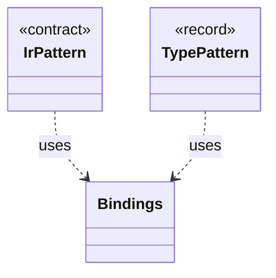

# `Bindings`

`io.github.tlaplus.hardening.signature` · class · other · [source](https://github.com/tlaplus/model-checker-hardening/blob/3b201567990514c2a43b90dca521dbe32af37023/src/main/java/io/github/tlaplus/hardening/signature/Bindings.java#L17) · module [signature](../modules/signature.md)

The metavariables and type variables one pattern alternative has bound so far.

The diagram draws 2 of 3 relations; the table lists them all.

| Direction | Relation | Type | Summary |
|---|---|---|---|
| ← | uses | [IrPattern](io.github.tlaplus.hardening.signature.IrPattern.md) | One pattern over the typed Apalache IR, as parsed by `PatternParser`. |
| ← | uses | [TypePattern](io.github.tlaplus.hardening.signature.TypePattern.md) | A type in Apalache's syntax whose type variables are wildcards. |
| ← | depends | [KnownDefect](io.github.tlaplus.hardening.signature.KnownDefect.md) | One known-defect signature: a documented tool defect and the IR shapes that trigger it. |
