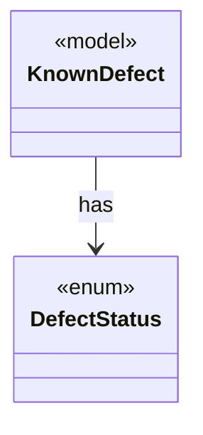

# `DefectStatus`

`io.github.tlaplus.hardening.signature` · enum · other · [source](https://github.com/tlaplus/model-checker-hardening/blob/5b16596dd480095d323ac67ff0f85eb85227b4b5/src/main/java/io/github/tlaplus/hardening/signature/DefectStatus.java#L13) · module [signature](../modules/signature.md)

Whether the defect behind a signature is still present.

The diagram draws 1 of 4 relations; the table lists them all.

| Direction | Relation | Type | Summary |
|---|---|---|---|
| ← | has | [KnownDefect](io.github.tlaplus.hardening.signature.KnownDefect.md) | One known-defect signature: a documented tool defect and the IR shapes that trigger it. |
| ← | depends | [KnownDefectReport](io.github.tlaplus.hardening.cli.KnownDefectReport.md) | Renders the known-defect signatures that match one decoded input: each signature's id, description, status, and references, and the subexpression it matched first, as TLA+. |
| ← | depends | [KnownDefectDatabase](io.github.tlaplus.hardening.signature.KnownDefectDatabase.md) | The known-defect signatures of one invocation, in database order. |
| ← | depends | [KnownDefectDatabaseReader](io.github.tlaplus.hardening.signature.KnownDefectDatabaseReader.md) | Reads one database file: a TOML document of `[[signature]]` tables with exactly the keys `id`, `references`, `description`, `status`, and `match`. |
