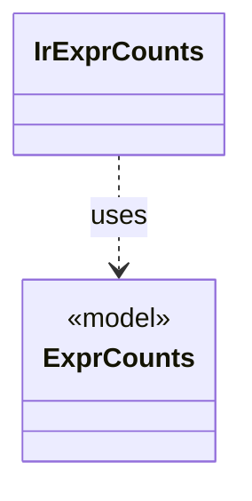

# `IrExprCounts`

`io.github.tlaplus.hardening.signature` · class · other · [source](https://github.com/tlaplus/model-checker-hardening/blob/af09a9e32eb710979ef0c76f29507ce1ffe85a15/src/main/java/io/github/tlaplus/hardening/signature/IrExprCounts.java#L27) · module [signature](../modules/signature.md)

Counts the size and constructs of the code the tools evaluate, over the walk that signatures match against.

The diagram draws 1 of 4 relations; the table lists them all.

| Direction | Relation | Type | Summary |
|---|---|---|---|
| → | uses | [ExprCounts](io.github.tlaplus.hardening.common.ExprCounts.md) | The size of a piece of TLA+ code, the occurrences of each expression construct in it, and the occurrences of each edge between constructs. |
| → | depends | [ExprEdge](io.github.tlaplus.hardening.common.ExprEdge.md) | An edge of an expression tree between two constructs: `parent` applied to, or binding, an immediate subexpression that is the construct `child`. |
| → | depends | [IrTree](io.github.tlaplus.hardening.signature.IrTree.md) | The subexpressions a signature is tried against: those the tools evaluate. |
| ← | depends | [EvaluatedExprs](io.github.tlaplus.hardening.workflow.spec.EvaluatedExprs.md) | Replays a stored input and counts the expression constructs of the code the checkers evaluate: the definitions reachable from `SpecArtifact.entryPoints`. |
