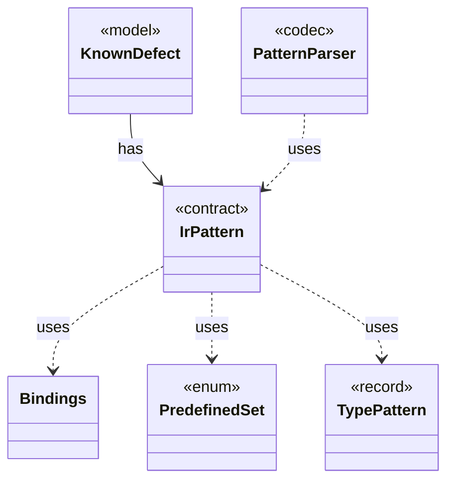

# `IrPattern`

`io.github.tlaplus.hardening.signature` · interface · contract · key · [source](https://github.com/tlaplus/model-checker-hardening/blob/21262d9d0cc07b5ae4c47c4ee511217c9b88b561/src/main/java/io/github/tlaplus/hardening/signature/IrPattern.java#L30) · module [signature](../modules/signature.md)

One pattern over the typed Apalache IR, as parsed by `PatternParser`.

The diagram draws 5 of 7 relations; the table lists them all.

| Direction | Relation | Type | Summary |
|---|---|---|---|
| ← | has | [KnownDefect](io.github.tlaplus.hardening.signature.KnownDefect.md) | One known-defect signature: a documented tool defect and the IR shapes that trigger it. |
| → | uses | [Bindings](io.github.tlaplus.hardening.signature.Bindings.md) | The metavariables and type variables one pattern alternative has bound so far. |
| → | uses | [PredefinedSet](io.github.tlaplus.hardening.signature.PredefinedSet.md) | The predefined sets a pattern names by their TLA+ spelling. |
| → | uses | [TypePattern](io.github.tlaplus.hardening.signature.TypePattern.md) | A type in Apalache's syntax whose type variables are wildcards. |
| ← | uses | [PatternParser](io.github.tlaplus.hardening.signature.PatternParser.md) | Parses the S-expression pattern syntax that the known-defect manual specifies: |
| → | depends | [IrTree](io.github.tlaplus.hardening.signature.IrTree.md) | The subexpressions a signature is tried against: those the tools evaluate. |
| ← | depends | [KnownDefectDatabaseReader](io.github.tlaplus.hardening.signature.KnownDefectDatabaseReader.md) | Reads one database file: a TOML document of `[[signature]]` tables with exactly the keys `id`, `references`, `description`, and `match`. |
