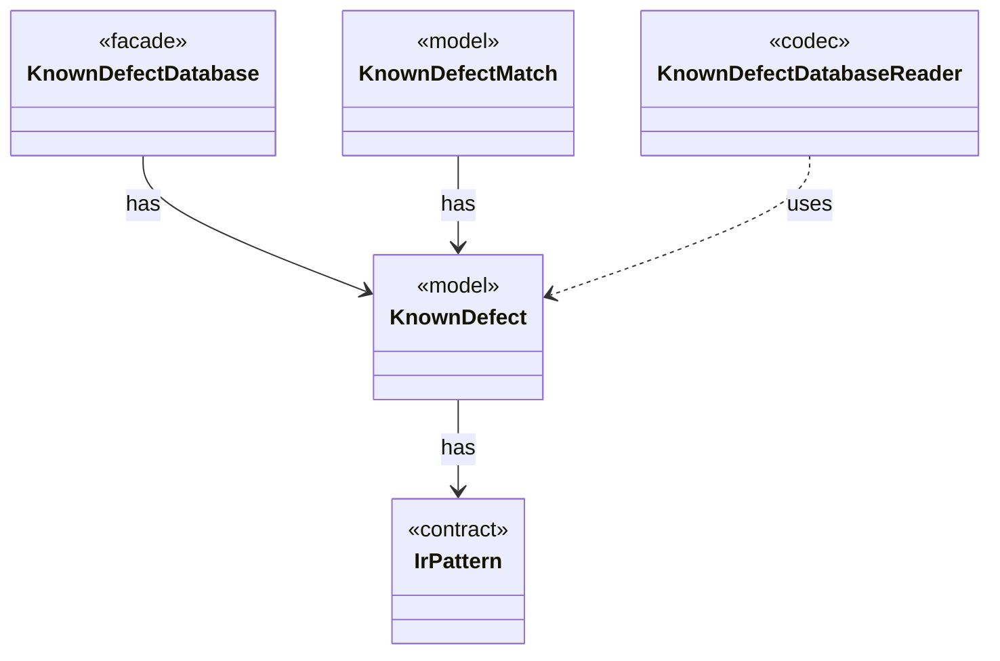

# `KnownDefect`

`io.github.tlaplus.hardening.signature` · class · model · key · [source](https://github.com/tlaplus/model-checker-hardening/blob/3b201567990514c2a43b90dca521dbe32af37023/src/main/java/io/github/tlaplus/hardening/signature/KnownDefect.java#L19) · module [signature](../modules/signature.md)

One known-defect signature: a documented tool defect and the IR shapes that trigger it.

The diagram draws 4 of 8 relations; the table lists them all.

| Direction | Relation | Type | Summary |
|---|---|---|---|
| → | has | [IrPattern](io.github.tlaplus.hardening.signature.IrPattern.md) | One pattern over the typed Apalache IR, as parsed by `PatternParser`. |
| ← | has | [KnownDefectDatabase](io.github.tlaplus.hardening.signature.KnownDefectDatabase.md) | The known-defect signatures of one invocation, in database order. |
| ← | has | [KnownDefectMatch](io.github.tlaplus.hardening.signature.KnownDefectMatch.md) | A signature that matches a module, and the outermost subexpression it matched first. |
| ← | uses | [KnownDefectDatabaseReader](io.github.tlaplus.hardening.signature.KnownDefectDatabaseReader.md) | Reads one database file: a TOML document of `[[signature]]` tables with exactly the keys `id`, `references`, `description`, and `match`. |
| → | depends | [Preconditions](io.github.tlaplus.hardening.common.Preconditions.md) | Shared validation of method and constructor arguments. |
| → | depends | [Bindings](io.github.tlaplus.hardening.signature.Bindings.md) | The metavariables and type variables one pattern alternative has bound so far. |
| ← | depends | [KnownDefectReport](io.github.tlaplus.hardening.cli.KnownDefectReport.md) | Renders the known-defect signatures that match one decoded input: each signature's id, description, and references, and the subexpression it matched first, as TLA+. |
| ← | depends | [InputAdmission](io.github.tlaplus.hardening.workflow.input.InputAdmission.md) | Decides whether a decoded candidate enters `00-inputs`, and where a known defect goes. |
