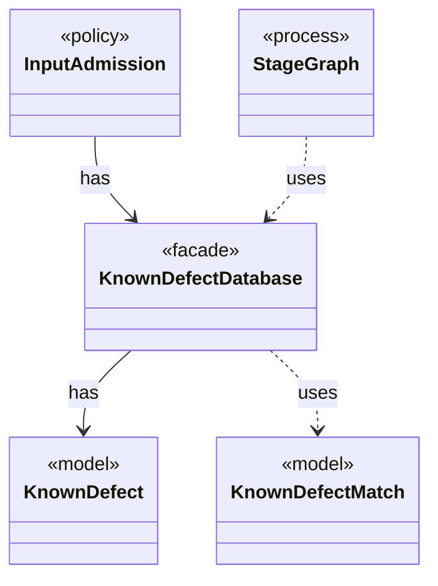

# `KnownDefectDatabase`

`io.github.tlaplus.hardening.signature` · class · facade · key · [source](https://github.com/tlaplus/model-checker-hardening/blob/6bd7d927f1cffd7642029a3d925dff47091ddde9/src/main/java/io/github/tlaplus/hardening/signature/KnownDefectDatabase.java#L20) · module [signature](../modules/signature.md)

The known-defect signatures of one invocation, in database order.

The diagram draws 4 of 10 relations; the table lists them all.

| Direction | Relation | Type | Summary |
|---|---|---|---|
| → | has | [KnownDefect](io.github.tlaplus.hardening.signature.KnownDefect.md) | One known-defect signature: a documented tool defect and the IR shapes that trigger it. |
| ← | has | [InputAdmission](io.github.tlaplus.hardening.workflow.input.InputAdmission.md) | Decides whether a decoded candidate enters `00-inputs`, and where a known defect goes. |
| → | uses | [KnownDefectMatch](io.github.tlaplus.hardening.signature.KnownDefectMatch.md) | A signature that matches a module, and the outermost subexpression it matched first. |
| ← | uses | [StageGraph](io.github.tlaplus.hardening.workflow.StageGraph.md) | The stages that run one workflow invocation, wired to their queues, result capacities, and shared collaborators, and the order in which they start and stop. |
| → | depends | [IrTree](io.github.tlaplus.hardening.signature.IrTree.md) | The subexpressions a signature is tried against: those the tools evaluate. |
| → | depends | [KnownDefectDatabaseException](io.github.tlaplus.hardening.signature.KnownDefectDatabaseException.md) | A known-defect database that cannot be read, or that does not follow the database format. |
| → | depends | [KnownDefectDatabaseReader](io.github.tlaplus.hardening.signature.KnownDefectDatabaseReader.md) | Reads one database file: a TOML document of `[[signature]]` tables with exactly the keys `id`, `references`, `description`, and `match`. |
| ← | depends | [InitCommand](io.github.tlaplus.hardening.cli.InitCommand.md) | `fuzztla init`: writes the default configuration of a new corpus and installs its libraries. |
| ← | depends | [PrintCommand](io.github.tlaplus.hardening.cli.PrintCommand.md) | `fuzztla print`: decodes a payload or corpus envelope and renders it, with the known defects it matches. |
| ← | depends | [WorkflowRunner](io.github.tlaplus.hardening.workflow.WorkflowRunner.md) | Runs generation, parsing, TLC, Apalache, conformance aggregation and the quality gate under one CPU budget. |
