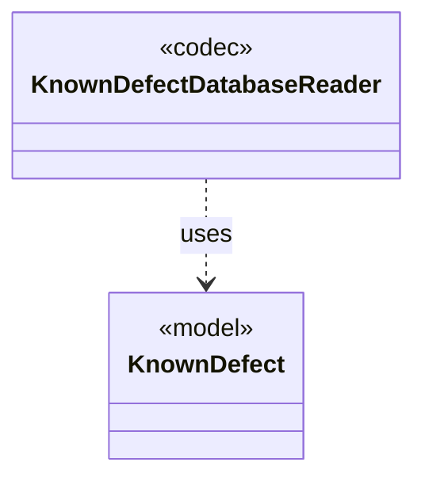

# `KnownDefectDatabaseReader`

`io.github.tlaplus.hardening.signature` · class · codec · key · [source](https://github.com/tlaplus/model-checker-hardening/blob/6bbf8b66c375696d1798f7b7a061b81573a3f42a/src/main/java/io/github/tlaplus/hardening/signature/KnownDefectDatabaseReader.java#L27) · module [signature](../modules/signature.md)

Reads one database file: a TOML document of `[[signature]]` tables with exactly the keys `id`, `references`, `description`, `status`, and `match`.

The diagram draws 1 of 8 relations; the table lists them all.

| Direction | Relation | Type | Summary |
|---|---|---|---|
| → | uses | [KnownDefect](io.github.tlaplus.hardening.signature.KnownDefect.md) | One known-defect signature: a documented tool defect and the IR shapes that trigger it. |
| → | depends | [Diagnostics](io.github.tlaplus.hardening.common.Diagnostics.md) | Human-readable diagnostic formatting for failures. |
| → | depends | [DefectStatus](io.github.tlaplus.hardening.signature.DefectStatus.md) | Whether the defect behind a signature is still present. |
| → | depends | [IrPattern](io.github.tlaplus.hardening.signature.IrPattern.md) | One pattern over the typed Apalache IR, as parsed by `PatternParser`. |
| → | depends | [KnownDefectDatabaseException](io.github.tlaplus.hardening.signature.KnownDefectDatabaseException.md) | A known-defect database that cannot be read, or that does not follow the database format. |
| → | depends | [PatternException](io.github.tlaplus.hardening.signature.PatternException.md) | A pattern that does not follow the pattern syntax, located by a one-based column. |
| → | depends | [PatternParser](io.github.tlaplus.hardening.signature.PatternParser.md) | Parses the S-expression pattern syntax that the known-defect manual specifies: |
| ← | depends | [KnownDefectDatabase](io.github.tlaplus.hardening.signature.KnownDefectDatabase.md) | The known-defect signatures of one invocation, in database order. |
