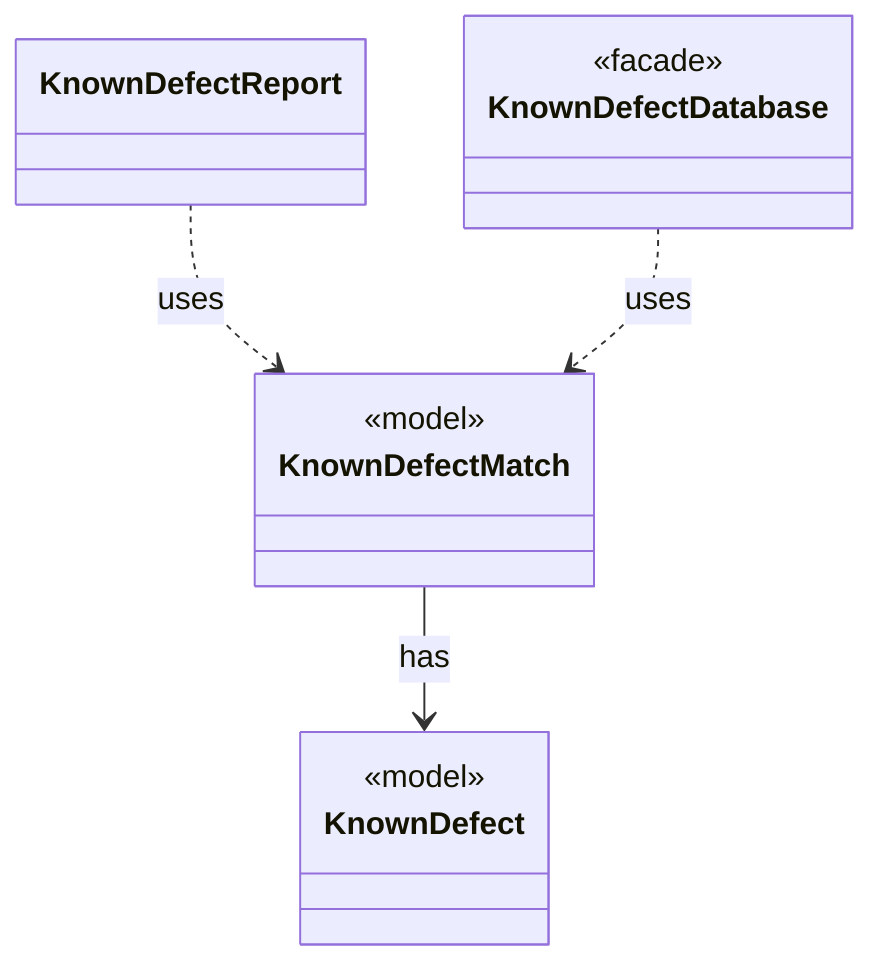

# `KnownDefectMatch`

`io.github.tlaplus.hardening.signature` · record · model · key · [source](https://github.com/tlaplus/model-checker-hardening/blob/21262d9d0cc07b5ae4c47c4ee511217c9b88b561/src/main/java/io/github/tlaplus/hardening/signature/KnownDefectMatch.java#L10) · module [signature](../modules/signature.md)

A signature that matches a module, and the outermost subexpression it matched first.

The diagram draws 3 of 4 relations; the table lists them all.

| Direction | Relation | Type | Summary |
|---|---|---|---|
| → | has | [KnownDefect](io.github.tlaplus.hardening.signature.KnownDefect.md) | One known-defect signature: a documented tool defect and the IR shapes that trigger it. |
| ← | uses | [KnownDefectReport](io.github.tlaplus.hardening.cli.KnownDefectReport.md) | Renders the known-defect signatures that match one decoded input: each signature's id, description, and references, and the subexpression it matched first, as TLA+. |
| ← | uses | [KnownDefectDatabase](io.github.tlaplus.hardening.signature.KnownDefectDatabase.md) | The known-defect signatures of one invocation, in database order. |
| ← | depends | [InputAdmission](io.github.tlaplus.hardening.workflow.input.InputAdmission.md) | Decides whether a decoded candidate enters `00-inputs`, and where a known defect goes. |
