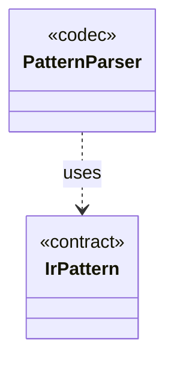

# `PatternParser`

`io.github.tlaplus.hardening.signature` · class · codec · key · [source](https://github.com/tlaplus/model-checker-hardening/blob/4f182776ab66c4f93ff45cb83dfcd11e34fa32d1/src/main/java/io/github/tlaplus/hardening/signature/PatternParser.java#L24) · module [signature](../modules/signature.md)

Parses the S-expression pattern syntax that the known-defect manual specifies:

The diagram draws 1 of 6 relations; the table lists them all.

| Direction | Relation | Type | Summary |
|---|---|---|---|
| → | uses | [IrPattern](io.github.tlaplus.hardening.signature.IrPattern.md) | One pattern over the typed Apalache IR, as parsed by `PatternParser`. |
| → | depends | [OperatorNames](io.github.tlaplus.hardening.signature.OperatorNames.md) | The operators a pattern may name, keyed by `TlaOper.name`. |
| → | depends | [PatternException](io.github.tlaplus.hardening.signature.PatternException.md) | A pattern that does not follow the pattern syntax, located by a one-based column. |
| → | depends | [PredefinedSet](io.github.tlaplus.hardening.signature.PredefinedSet.md) | The predefined sets a pattern names by their TLA+ spelling. |
| → | depends | [TypePattern](io.github.tlaplus.hardening.signature.TypePattern.md) | A type in Apalache's syntax whose type variables are wildcards. |
| ← | depends | [KnownDefectDatabaseReader](io.github.tlaplus.hardening.signature.KnownDefectDatabaseReader.md) | Reads one database file: a TOML document of `[[signature]]` tables with exactly the keys `id`, `references`, `description`, and `match`. |
