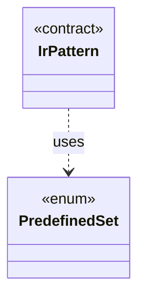

# `PredefinedSet`

`io.github.tlaplus.hardening.signature` · enum · other · [source](https://github.com/tlaplus/model-checker-hardening/blob/ed5c97e61582ad2ff90b4ea4209355aa0d555717/src/main/java/io/github/tlaplus/hardening/signature/PredefinedSet.java#L15) · module [signature](../modules/signature.md)

The predefined sets a pattern names by their TLA+ spelling.

The diagram draws 1 of 2 relations; the table lists them all.

| Direction | Relation | Type | Summary |
|---|---|---|---|
| ← | uses | [IrPattern](io.github.tlaplus.hardening.signature.IrPattern.md) | One pattern over the typed Apalache IR, as parsed by `PatternParser`. |
| ← | depends | [PatternParser](io.github.tlaplus.hardening.signature.PatternParser.md) | Parses the S-expression pattern syntax that the known-defect manual specifies: |
