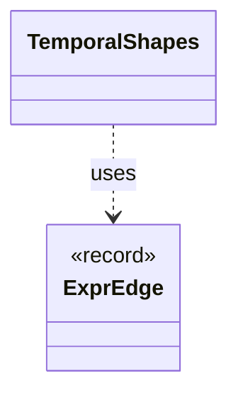

# `TemporalShapes`

`io.github.tlaplus.hardening.signature` · class · other · [source](https://github.com/tlaplus/model-checker-hardening/blob/39531345378d8db5a429220f50aed4254ea670fb/src/main/java/io/github/tlaplus/hardening/signature/TemporalShapes.java#L35) · module [signature](../modules/signature.md)

Counts the temporal shapes of a module's properties (ADR 0028 §2).

**Decisions:** [ADR 0028: Temporal properties that read the state](https://github.com/tlaplus/model-checker-hardening/blob/39531345378d8db5a429220f50aed4254ea670fb/docs/decisions/0028-temporal-property-quality.md)

The diagram draws 1 of 3 relations; the table lists them all.

| Direction | Relation | Type | Summary |
|---|---|---|---|
| → | uses | [ExprEdge](io.github.tlaplus.hardening.common.ExprEdge.md) | An edge of an expression tree between two constructs: `parent` applied to, or binding, an immediate subexpression that is the construct `child`. |
| → | depends | [IrTree](io.github.tlaplus.hardening.signature.IrTree.md) | The subexpressions a signature is tried against: those the tools evaluate. |
| ← | depends | [EvaluatedExprs](io.github.tlaplus.hardening.workflow.spec.EvaluatedExprs.md) | Replays a stored input and counts the expression constructs of the code the checkers evaluate: the definitions reachable from `SpecArtifact.entryPoints`. |
