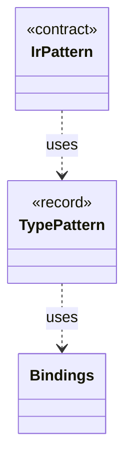

# `TypePattern`

`io.github.tlaplus.hardening.signature` · record · other · [source](https://github.com/tlaplus/model-checker-hardening/blob/ed5c97e61582ad2ff90b4ea4209355aa0d555717/src/main/java/io/github/tlaplus/hardening/signature/TypePattern.java#L22) · module [signature](../modules/signature.md)

A type in Apalache's syntax whose type variables are wildcards.

The diagram draws 2 of 4 relations; the table lists them all.

| Direction | Relation | Type | Summary |
|---|---|---|---|
| → | uses | [Bindings](io.github.tlaplus.hardening.signature.Bindings.md) | The metavariables and type variables one pattern alternative has bound so far. |
| ← | uses | [IrPattern](io.github.tlaplus.hardening.signature.IrPattern.md) | One pattern over the typed Apalache IR, as parsed by `PatternParser`. |
| → | depends | [Type1Syntax](io.github.tlaplus.hardening.signature.Type1Syntax.md) | Parses Apalache's type syntax, the syntax of the `type` fields in its IR JSON. |
| ← | depends | [PatternParser](io.github.tlaplus.hardening.signature.PatternParser.md) | Parses the S-expression pattern syntax that the known-defect manual specifies: |
