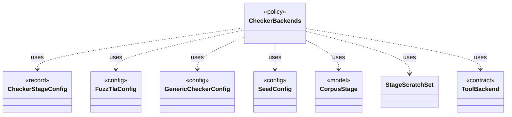

# `CheckerBackends`

`io.github.tlaplus.hardening.workflow` · class · policy · key · [source](https://github.com/tlaplus/model-checker-hardening/blob/4bb4de908e112f3701f8f30b6bcd32c25707bdd7/src/main/java/io/github/tlaplus/hardening/workflow/CheckerBackends.java#L29) · module [workflow](../modules/workflow.md)

How each model-checker stage builds its backend for one invocation.

The diagram draws 7 of 16 relations; the table lists them all.

| Direction | Relation | Type | Summary |
|---|---|---|---|
| → | uses | [CheckerStageConfig](io.github.tlaplus.hardening.config.CheckerStageConfig.md) | Capacity and resource limits for one model-checker stage. |
| → | uses | [FuzzTlaConfig](io.github.tlaplus.hardening.config.FuzzTlaConfig.md) | Complete configuration of input generation and workflow execution. |
| → | uses | [GenericCheckerConfig](io.github.tlaplus.hardening.config.GenericCheckerConfig.md) | The `[generic]` table (ADR 0033 §1): a model checker that claims compatibility with TLC or Apalache, run as a native process for each input. |
| → | uses | [SeedConfig](io.github.tlaplus.hardening.config.SeedConfig.md) | The `[seeds]` table (ADR 0026): every random seed a run uses. |
| → | uses | [CorpusStage](io.github.tlaplus.hardening.corpus.CorpusStage.md) | One implemented stage of the fuzzing pipeline, and the corpus directories it owns. |
| → | uses | [StageScratchSet](io.github.tlaplus.hardening.corpus.StageScratchSet.md) | The transient scratch directories of every stage that needs one, created and removed together. |
| → | uses | [ToolBackend](io.github.tlaplus.hardening.workflow.tool.ToolBackend.md) | Tool-specific behavior injected into the shared `ToolStage`. |
| → | depends | [Preconditions](io.github.tlaplus.hardening.common.Preconditions.md) | Shared validation of method and constructor arguments. |
| → | depends | [ToolsConfig](io.github.tlaplus.hardening.config.ToolsConfig.md) | The tools a corpus checks and types with: the JARs of the `[tools]` table (ADR 0025 §3), and the generic checker of the `[generic]` table (ADR 0033). |
| → | depends | [CorpusTools](io.github.tlaplus.hardening.workflow.CorpusTools.md) | The tool JARs a corpus runs (ADR 0025 §3): those of its `[tools]` table, or the ones staged with FuzzTLA for a tool the table leaves out. |
| → | depends | [ApalacheCheckerBackend](io.github.tlaplus.hardening.workflow.apalache.ApalacheCheckerBackend.md) | Adapts persistent Apalache tool workers to the shared tool stage. |
| → | depends | [GenericCheckerBackend](io.github.tlaplus.hardening.workflow.generic.GenericCheckerBackend.md) | Runs the generic checker of ADR 0033 as one native process per input, the lifecycle `ToolBackend` describes for TLC, but without a JVM. |
| → | depends | [TlcCheckerBackend](io.github.tlaplus.hardening.workflow.tlc.TlcCheckerBackend.md) | Adapts fresh isolated TLC invocations to the shared tool stage. |
| → | depends | [TlcSettings](io.github.tlaplus.hardening.workflow.tlc.TlcSettings.md) | What one TLC stage launches its JVMs with: the stage's limits and the TLC seeds of ` [seeds]` (ADR 0026), which every TLC stage shares. |
| ← | depends | [MetamorphicShrinker](io.github.tlaplus.hardening.workflow.MetamorphicShrinker.md) | Reduces a metamorphic counterexample for triage (ADR 0016 §8). |
| ← | depends | [StageGraph](io.github.tlaplus.hardening.workflow.StageGraph.md) | The stages that run one workflow invocation, wired to their queues, result capacities, and shared collaborators, and the order in which they start and stop. |
